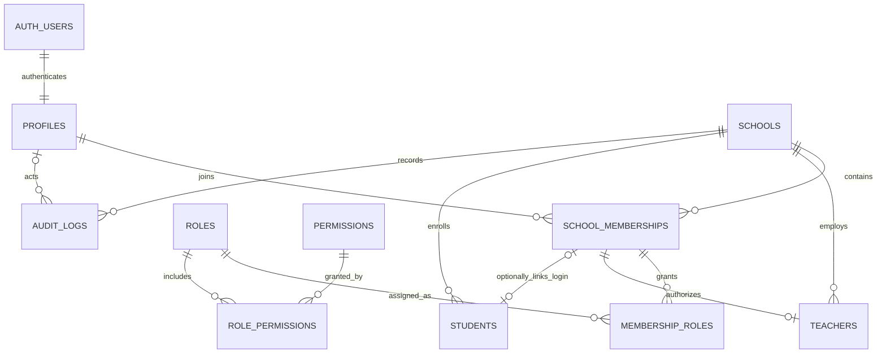

# Foundation Entity Relationship Diagram

**Scope:** 0.1 foundation plus target-domain relationships for later milestones
**Status:** Proposed baseline for Product Owner and Technical Lead review
**Related:** [Database Schema](DATABASE_SCHEMA.md), [Permissions](PERMISSIONS.md)

`AUTH_USERS` is Supabase Auth's managed identity table, not an application-owned table. Application code must not write to it directly. `PROFILES` represents an authenticated user. A student record may exist without a profile or login; when a student account is provisioned, its school membership is linked to that student's record.

Roles and permissions are global stable definitions in 0.1. A user's effective role is granted through a school membership, so the same user can hold different roles in different schools. All operational profiles and audit records are school-scoped.

## Target-Domain Relationships

The following is the planned logical model, not a direction to create every table in 0.1. Introduce each domain in its roadmap milestone. Optional projections/caches are not sources of truth.

```mermaid
erDiagram
    SCHOOLS ||--o{ BRANCHES : has
    SCHOOLS ||--o{ ACADEMIC_TERMS : schedules
    SCHOOLS ||--o{ GROUPS : organizes
    BRANCHES o|--o{ GROUPS : hosts
    ACADEMIC_TERMS o|--o{ GROUPS : contains
    GROUPS ||--o{ GROUP_SCHEDULES : meets
    GROUPS ||--o{ TEACHER_GROUPS : assigns
    TEACHERS ||--o{ TEACHER_GROUPS : teaches
    GROUPS ||--o{ GROUP_STUDENTS : enrolls
    STUDENTS ||--o{ GROUP_STUDENTS : attends

    PROFILES ||--o| GUARDIANS : represents
    GUARDIANS ||--o{ STUDENT_GUARDIANS : links
    STUDENTS ||--o{ STUDENT_GUARDIANS : linked_to

    QURAN_DATASETS ||--|{ SURAHS : defines
    SURAHS ||--|{ AYAHS : contains
    QURAN_DATASETS ||--o{ QURAN_PAGES : maps
    QURAN_DATASETS ||--o{ JUZ : maps
    QURAN_DATASETS ||--o{ HIZB : maps
    QURAN_DATASETS ||--o{ RUB_QUARTERS : maps

    SCHOOLS ||--o{ HOMEWORK : assigns
    TEACHERS ||--o{ HOMEWORK : creates
    HOMEWORK ||--o{ HOMEWORK_RANGES : covers
    QURAN_DATASETS ||--o{ HOMEWORK_RANGES : references
    HOMEWORK ||--|{ HOMEWORK_RECIPIENTS : targets
    STUDENTS ||--o{ HOMEWORK_RECIPIENTS : receives
    HOMEWORK_RECIPIENTS ||--o{ MEMORIZATION_SESSIONS : assessed_in
    STUDENTS ||--o{ MEMORIZATION_SESSIONS : performs
    TEACHERS ||--o{ MEMORIZATION_SESSIONS : records
    MEMORIZATION_SESSIONS ||--o| SESSION_ASSESSMENTS : has
    SESSION_ASSESSMENTS ||--o{ ASSESSMENT_AMENDMENTS : corrected_by
    SCORING_RULE_VERSIONS o|--o{ SESSION_ASSESSMENTS : scores_with
    STUDENTS ||--o{ TEACHER_NOTES : has
    TEACHERS ||--o{ TEACHER_NOTES : writes
    SESSION_ASSESSMENTS ||--o{ MEMORIZATION_COVERAGE : projects
    STUDENTS ||--o{ MEMORIZATION_COVERAGE : covered_for
    STUDENTS ||--o{ PROGRESS_SNAPSHOTS : summarized_by

    GROUPS ||--o{ GROUP_MEETINGS : hosts
    GROUP_MEETINGS ||--o{ ATTENDANCE_RECORDS : records
    STUDENTS ||--o{ ATTENDANCE_RECORDS : marked_for
    ATTENDANCE_RECORDS ||--o{ ATTENDANCE_AMENDMENTS : corrected_by

    SCHOOLS ||--o{ SCORING_RULE_VERSIONS : configures
    SCHOOLS ||--o{ POINTS_LEDGER : records
    STUDENTS ||--o{ POINTS_LEDGER : earns
    SCHOOLS ||--o{ ACHIEVEMENTS : defines
    STUDENTS ||--o{ STUDENT_ACHIEVEMENTS : earns
    ACHIEVEMENTS ||--o{ STUDENT_ACHIEVEMENTS : awarded_as
    SCHOOLS ||--o{ COMPETITIONS : hosts
    COMPETITIONS ||--o{ COMPETITION_PARTICIPANTS : includes
    STUDENTS ||--o{ COMPETITION_PARTICIPANTS : enters
    COMPETITION_PARTICIPANTS ||--o{ COMPETITION_SCORE_EVENTS : scores
    COMPETITIONS ||--o{ LEADERBOARD_SNAPSHOTS : snapshots

    PROFILES ||--o{ NOTIFICATIONS : receives
    PROFILES ||--o{ NOTIFICATION_PREFERENCES : configures
    PROFILES ||--o{ DEVICE_TOKENS : registers
    SCHOOLS ||--o{ OUTBOX_EVENTS : emits
    OUTBOX_EVENTS ||--o{ DELIVERY_ATTEMPTS : retries
    PROFILES ||--o{ SYNC_MUTATIONS : submits
    SCHOOLS ||--o{ SYNC_MUTATIONS : scopes
    SCHOOLS ||--o{ FILE_ASSETS : owns
```

All joins between school-owned rows must include/validate the same `school_id`, even when it is omitted from the relationship drawing. Qur'an reference tables are global and immutable to school users. Generic resource IDs in audit, file, or event records are not substitutes for validated foreign keys and authorization.