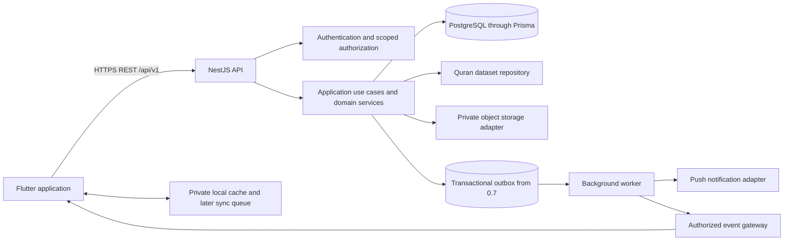
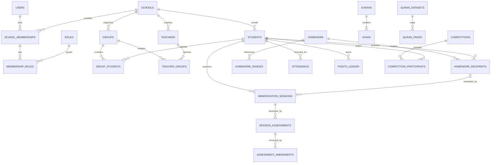

# Qur’an School Management — Project Plan

> **Superseded planning draft:** This document describes a Flutter/NestJS-first approach and is retained for historical reference only. The confirmed V1 stack is React Native + Expo + TypeScript + Supabase. Use [QURAN_SCHOOL_REACT_NATIVE_SUPABASE_V1_NESTJS_LATER_PROJECT_PLAN.md](QURAN_SCHOOL_REACT_NATIVE_SUPABASE_V1_NESTJS_LATER_PROJECT_PLAN.md) for product and architecture details, and [BUILD_TASK_LIST.md](BUILD_TASK_LIST.md) for execution order. Do not use the Flutter implementation tasks below.

**Created:** 4 October 2026  
**Status:** Planning; application implementation has not started.  
**Source:** The supplied Qur’an school application brief.  
**First implementation milestone:** Version `0.1.0` — Foundation.

## 1. How to work from this plan

This document turns the brief into an ordered development backlog. It includes a starting PRD and architecture, the design documents to finish before coding, and release checklists through the first production release.

- Work on one version at a time. Later-version items describe planned scope, not permission to implement them early.
- Finish the pre-implementation design deliverables before writing application code.
- Mark a task `[x]` only when its deliverable exists and its acceptance criteria have been verified.
- Keep every completed version runnable and upgradeable through migrations.
- Record architecture changes in decision records and update this plan when scope changes.
- Use `0.x.0` milestone versions and `0.x.y` fixes. Keep API versions independent of application releases.
- Do not treat a completed checklist as proof of production readiness; the release checks in section 17 must also pass.

Priority order: correct Qur’an references; student privacy; reliable history; teacher usability; Arabic-first experience; maintainability; scalability; gamification.

## 2. Starting Product Requirements Document

### 2.1 Product purpose

Build an Arabic-first Flutter mobile application that helps Qur’an schools manage teachers, students, groups, memorization, revision, homework, attendance, and healthy competitions. Teachers should be able to record a lesson quickly, and students should be able to see the resulting progress and next assignment clearly.

Start with one operating school while enforcing school boundaries in the data model and backend from the beginning. Add branch management and multi-school self-service in later releases without rebuilding the core.

### 2.2 Users and responsibilities

| User | Primary outcome |
| --- | --- |
| Administrator | Manage school accounts, groups, terms, settings, scoring rules, reports, and competitions. |
| Teacher | Manage authorized groups; assign work; record attendance and lesson results; identify students needing attention. |
| Student | View personal homework, Qur’an ranges, progress, history, scores, feedback, attendance, and permitted rankings. |
| Future guardian | View explicitly linked children's records and authorized teacher messages. |
| Future school/branch manager | Manage records within the granted school or branch scope. |
| Future super admin | Perform separately controlled platform administration with audited access. |

### 2.3 Version 0.1 functional requirements

| ID | Requirement | Acceptance criterion |
| --- | --- | --- |
| F01 | Create a school and its first administrator through a controlled bootstrap process. | Setup works without public administrator registration or production database edits. |
| F02 | Administrator creates basic teacher and student profiles. | Validated profiles are associated with the administrator's school and appear in authorized lists. |
| F03 | Support activation, login, token refresh, logout, and password reset. | Valid accounts can enter the app; expired/revoked credentials fail; reset responses do not reveal account existence. |
| F04 | Enforce administrator, teacher, and student permissions. | A student cannot read another student's profile; users from one school cannot access another school. |
| F05 | Provide a minimal dashboard and profile screen for each role. | Navigation is driven by authenticated permissions; no later-version statistics are presented as real data. |
| F06 | Support Arabic and English from the first screen. | Login, validation, navigation, and profile screens work in RTL and LTR. |
| F07 | Provide typed REST contracts, relational migrations, and meaningful automated tests. | A clean database can be migrated and seeded; documented API examples match tested behavior. |
| F08 | Record sensitive foundation actions in an audit log. | Account creation, role changes, authentication security events, and profile changes are traceable without exposing secrets. |

### 2.4 Version 0.1 boundaries

Version 0.1 includes school identity, configurable role permissions, authentication, basic teacher/student records, profile access, role navigation, localization, database migrations, and CI foundations.

Group membership workflows begin in 0.2. Memorization and generic homework begin in 0.3. The Qur’an reader begins in 0.4. Revision and attendance begin in 0.5. Competitions begin in 0.6. Real-time delivery begins in 0.7. Analytics begin in 0.8. Complete offline writes and production hardening finish in 0.9.

Plan the full schema now, but migrate only the tables required by each version. Verify and import Qur’an reference metadata before implementing memorization in 0.3; the full reader does not need to exist for structured assignment references to work.

### 2.5 Product quality requirements

- Keep student educational records private and disclose only fields needed for the authorized workflow.
- Keep historical lessons and assessments immutable; correct them through attributed amendments.
- Treat Arabic layouts, Qur’an font rendering, accessibility, and both display directions as first-class design requirements.
- Derive progress from verified lessons and unique verse coverage, rather than editable totals.
- Keep services stateless where practical, paginate lists, index common queries, and measure realistic workloads before scaling.
- Define measurable API latency, availability, backup recovery, and mobile performance targets during the deployment design stage.
- Preserve existing features and historical meaning through schema and scoring-rule changes.

### 2.6 First production release success criteria

- An administrator can configure a school, term, groups, teachers, and students.
- A teacher can select Qur’an verses, assign work, record attendance, assess a lesson, and see updated progress.
- A student can open the assignment in the reader and view only their authorized educational records.
- Revision, configurable competitions, notifications, and role dashboards work according to school settings.
- Offline lesson submissions reconcile safely without duplicated lessons, progress, or points.
- A real school completes a monitored pilot; security, migration, and backup restoration checks pass before release.

## 3. Architecture recommendations

These are proposed defaults for the planning work. Record the final choices in architecture decision records before implementation. Pin supported toolchain and package versions at project setup; this plan does not prescribe floating package versions.

### 3.1 Backend: NestJS + TypeScript + PostgreSQL + Prisma

Recommend Option A because this project has substantial business rules: school-scoped permissions, permanent assessment history, transactional progress updates, configurable scoring, and offline replay. A modular backend gives these rules a clear home and lets REST, future GraphQL, and background workers share application use cases.

NestJS supports feature modules and explicitly exported providers, which suits the planned domain boundaries. See [NestJS modules](https://docs.nestjs.com/modules). Prisma provides transaction facilities for related database changes. See [Prisma transactions](https://www.prisma.io/docs/orm/fundamentals/transactions).

| Option | Advantages for this project | Responsibilities/tradeoffs |
| --- | --- | --- |
| NestJS + Prisma | Explicit domain services, consistent REST contracts, controllable transaction boundaries, flexible provider adapters. | Operate an API service and background processing; build and maintain authentication integrations. |
| Supabase + Edge Functions | Managed database/authentication services and an alternative route to subscriptions and storage. | Express complex rules in functions/services, rigorously design RLS, and preserve provider-independent domain boundaries. |

Supabase remains a viable alternative if team capacity favors managed services. Its documentation requires row-level security for exposed-schema tables; see [Supabase row-level security](https://supabase.com/docs/guides/database/postgres/row-level-security). The preference for NestJS here is a project design judgment, not a claim that Supabase cannot support the product.

### 3.2 Mobile: Flutter + Riverpod

Recommend Riverpod for dependency injection and asynchronous state management across feature repositories and use cases. This is a proposed implementation choice: validate it with a small authentication/profile flow in 0.1. Bloc is an acceptable alternative if the team already has strong Bloc experience; document a single consistent choice.

- Feature-first Clean Architecture: `data`, `domain`, and `presentation` inside each feature.
- Widgets render state and dispatch actions; business rules live in use cases and backend domain services.
- Domain models do not depend on Flutter widgets, HTTP clients, or database libraries.
- Repositories mediate remote services and local caches. Flutter's [offline-first guidance](https://docs.flutter.dev/app-architecture/design-patterns/offline-first) describes repositories coordinating local and remote sources.
- Use secure device storage for credentials and a SQLite-based local store, such as Drift, for cached records and the later synchronization queue.
- Use localization resources, directional layout primitives, and appropriate licensed Arabic/Qur’an fonts.

### 3.3 System shape

Start with a modular monolith and one PostgreSQL database. Add a worker process when scheduled notifications and other asynchronous tasks require it. Keep microservice extraction an evidence-driven future choice.



The diagram describes the target architecture; workers, push, real-time delivery, and complete offline writes are not 0.1 deliverables.

### 3.4 Backend module boundaries

| Module | Responsibility | First version |
| --- | --- | --- |
| Identity/access | Accounts, credentials, sessions, memberships, permissions, activation/reset. | 0.1 |
| Schools/settings | Tenant identity and school configuration; later branch configuration. | 0.1 |
| Students/teachers | Profiles and authorized profile access. | 0.1 |
| Audit | Attributed sensitive-operation history. | 0.1 |
| Groups/terms | Terms, schedules, teacher assignments, student memberships. | 0.2 |
| Qur’an data | Validated reference metadata, text repository, dataset adapters. | 0.3 metadata; 0.4 reader |
| Homework/memorization | Assignments, recipients, evaluations, history, progress. | 0.3 |
| Revision/attendance | Revision policy, revision results, scheduled attendance records. | 0.5 |
| Scoring/gamification | Rule versions, immutable points ledger, achievements, competitions. | 0.3 lesson scores; 0.6 gamification |
| Events/notifications | Durable event delivery, subscriptions, alerts, device tokens. | 0.7 |
| Analytics | Authorized aggregates, dashboards, trends, attention indicators. | 0.8 |
| Synchronization | Replay protection, conflicts, safe offline reconciliation. | Design early; finish 0.9 |

Controllers validate transport inputs and call use cases. Use cases enforce permissions and business rules, coordinate transactions, and call repositories. Provider adapters isolate Qur’an data, storage, email, push, and future AI dependencies. Future GraphQL resolvers call the same use cases.

## 4. Roles, permissions, and tenant isolation

Use permissions plus resource scope, not a single role string on `users`. A user can have memberships and roles in different schools. Authorization combines the active school, effective permissions, and the particular record's relationship to the user.

| Action | Administrator | Teacher | Student |
| --- | --- | --- | --- |
| Manage teacher/student accounts | Own school | No | No |
| Read teacher/student profiles | Own school | Own profile and students in active authorized groups | Own profile only |
| Manage groups, terms, and settings | Own school | Read assigned groups | Read relevant own group information |
| Assign homework | With explicit teaching permission | Active authorized groups/students | No |
| Record lessons, scores, and attendance | With explicit teaching permission | Active authorized groups/students | No |
| Correct a historical evaluation | Explicit correction permission; audited amendment | Explicit correction permission in authorized scope | No |
| Read scores, history, feedback | Own school | Active authorized student scope | Own records only |
| Manage scoring rules/competitions | Own school | Only if separately delegated | No |
| Read rankings | School visibility policy | School visibility policy within authorized scope | Only permitted competitions/rankings |
| Read audit logs | Explicit audit permission | No by default | No |

Implementation rules:

- Every tenant-owned record carries `school_id`; shared Qur’an reference data is global and read-only to application users.
- Validate membership server-side before accepting an active school context. A submitted `school_id` is not authorization.
- Scope list queries, counts, exports, search, attachments, background jobs, and subscriptions as well as detail endpoints.
- Use composite tenant-aware foreign keys/constraints where needed to prevent cross-school relationships.
- Model optional branch scope without assuming that every future role has school-wide access.
- Enforce the same permissions on offline replay as on online requests; revoked group access must block queued submissions.
- Add PostgreSQL RLS as defense in depth where operationally appropriate. Specify transaction-local tenant context, connection-pool behavior, and a non-bypass runtime role before enabling it with Prisma.
- Test unauthenticated, wrong-role, wrong-school, wrong-group, and own-record scenarios for sensitive operations.
- Reserve future guardian links and platform-admin permissions; do not grant them through today's school administrator role.

## 5. Database design plan

### 5.1 Foundation tables for 0.1

| Entity | Important fields and constraints |
| --- | --- |
| `schools` | UUID, name, default locale, timezone, status, settings references. |
| `users` | Global account UUID, display name, account status; keep credentials separate from school roles. |
| `auth_identities` | User, login method, normalized identifier, password hash where applicable; documented uniqueness rules. |
| `school_memberships` | School, user, status; unique school/user membership. |
| `roles`, `permissions`, `role_permissions` | Stable permission codes, extensible role definitions. |
| `membership_roles` | School membership, role; support multiple roles without duplicating accounts. |
| `teachers` | School, user/membership link, teacher identifier, profile fields. |
| `students` | School, optional login account link, student identifier, date of birth, enrollment, level, configurable profile fields. |
| `refresh_sessions` | User, token hash, expiration, revocation, rotation-family metadata. |
| `account_action_tokens` | Hashed one-time activation/reset tokens with purpose, expiry, and consumed timestamp. |
| `audit_logs` | School where applicable, actor, action, resource, timestamp, request ID, redacted change metadata. |

A student profile may exist before account activation. Profile existence must not depend on the child having an email address. Exact fields, data types, deletion rules, and indexes belong in the complete schema deliverable.

### 5.2 Target entity catalog

| Domain | Planned entities | Design notes |
| --- | --- | --- |
| Organization | `branches`, `academic_terms`, `groups`, `group_schedules`, `teacher_groups`, `group_students` | Membership start/end dates preserve historical group context. Enforce one active student group initially, while allowing later multiple membership policy. |
| Guardians | `guardians`, `student_guardians` | Model consent/link verification before future parent access. |
| Qur’an | `quran_datasets`, `surahs`, `ayahs`, `quran_pages`, `juz`, `hizb`, `rub_quarters`, dataset-specific mappings | Stable verse references; page and division metadata tied to an identified edition/dataset. |
| Homework | `homework`, `homework_ranges`, `homework_recipients` | One assignment definition can have many recipients, each with independent status, deadlines where overridden, and evaluations. |
| Lessons | `memorization_sessions`, `session_assessments`, `assessment_amendments`, `teacher_notes` | Permanent session history; append amendments; notes have explicit visibility. |
| Progress | `memorization_coverage`, `progress_snapshots` where needed | Rebuildable projections from effective accepted assessments; do not treat snapshots as the source of truth. |
| Revision | Revision assignment/assessment policy within homework and sessions | Use assignment types rather than duplicate revision/homework stores; add subtype tables only for real differences. |
| Attendance | `group_meetings`, `attendance` | Unique record per student/meeting; configurable attendance statuses and amendment history. |
| Scoring | `scoring_rule_versions`, assessment score fields | Preserve the applied rule version and components; add separate `scores` only if a distinct use case requires it. |
| Gamification | `points_ledger`, `achievements`, `student_achievements`, `competitions`, `competition_participants`, `competition_score_events` | Server-generated awards, scoped uniqueness, corrections/reversals, competition eligibility and rule snapshots. |
| Rankings | Queries/materialized views or cached `leaderboard_snapshots` | Rankings are derived, dated, privacy-filtered data, not an editable score source. |
| Messaging infrastructure | `notifications`, `notification_preferences`, `device_tokens`, `outbox_events`, `delivery_attempts` | Durable dispatch, deduplicated deliveries, private event payloads. |
| Sync | `sync_mutations` or endpoint-specific idempotency records | Actor, school, mutation key, payload hash, result, resource version, retention policy. |
| Files | `file_assets` | Private owner/school scope, content type, size, storage key, upload/scan state. |

The brief's `memorization_assignments`, `revision_assignments`, `scores`, `competition_scores`, and `leaderboards` are evaluated above. Choose unified records, subtype tables, or derived views deliberately in the schema ADR; do not create duplicate sources of truth simply to reproduce the example table list.

### 5.3 Database invariants

- UUID primary keys for application/reference entities; preserve standard Surah/Ayah numbering as constrained reference fields.
- UTC `timestamptz` storage; school timezone drives schedules, due-date presentation, reporting windows, and streak boundaries.
- `created_at`, `updated_at`, and `created_by` where meaningful; immutable events use creation/amendment metadata rather than in-place updates.
- Soft deletion for mutable operational records where useful; never erase lesson history through a routine profile deletion. Define separate retention/anonymization procedures.
- Tenant-scoped unique student/teacher identifiers, normalized login identities, and appropriate foreign keys.
- Index school/status lists, group memberships, student/date histories, due-date/status queries, and event processing queues.
- Constrain valid verse ordering, score bounds, dates, statuses, same-school relationships, and duplicate-recipient/session keys.
- Use transactions for assessments, assignment state, progress changes, audit entries, and later points/outbox records.
- Add concurrency control for competing evaluations and permission checks; a uniqueness key alone does not prevent conflicting results.
- Use migrations for every change; review raw SQL when constraints or indexes exceed Prisma schema capabilities.
- Test migrations on an empty database and an upgrade database; production changes use controlled pipelines.

### 5.4 High-level ER diagram



This diagram shows key relationships; it is not the complete physical schema. Complete entity attributes, verse mapping relationships, constraints, and deletion behavior before coding.

## 6. Qur’an integration and progress rules

### 6.1 Dataset selection and validation

- [ ] Select an approved text/reference source and identify the supported riwayah, orthography, mushaf edition, and page layout.
- [ ] Confirm licensing for distribution, offline storage, fonts, search, and any future audio.
- [ ] Record provenance, dataset version, checksums, and verification evidence.
- [ ] Verify all Surahs, Ayah counts, order, text integrity, and page/Juz/Hizb/quarter mappings for that source.
- [ ] Define Basmala numbering/display behavior for the selected dataset.
- [ ] Obtain knowledgeable human review of reference data and representative rendering before using it in lessons.
- [ ] Store text in a data layer; keep provider-specific IDs out of widgets and domain contracts.
- [ ] Preserve the dataset version on historical assignments. A provider replacement must retain stable verse identities or supply a reviewed mapping.

Use a stable Ayah ordinal to compare start/end references across Surahs. Preserve Surah/Ayah fields for validation and display. Page mappings may require span/join records when the chosen edition does not map one whole Ayah to a single page.

### 6.2 Assignment and assessment semantics

- Support new memorization, recent revision, old revision, full-Surah review, Juz review, reading, Tajweed exercise, and custom homework.
- Keep custom instructions separate from structured Qur’an references. Custom work may omit a range; Qur’an-dependent types require valid ranges.
- Maintain independent recipient status: assigned, in progress, awaiting review, completed, needs revision, or cancelled. Derive overdue from due date and effective status.
- Separate student self-reported completion from teacher-verified completion.
- Store the actual assessed range, which may be smaller than the assigned range, with accuracy, fluency, Tajweed, mistakes, prompts, notes, and pass/revision decision.
- Snapshot the applicable scoring/pass policy so historical results remain explainable.
- Allow “record lesson + assign next work” as one intentional workflow without conflating the two records.

### 6.3 Correct progress calculation

- The teacher's accepted memorization assessments determine verified verse coverage.
- Count the union of verified ranges, not the sum of their lengths; overlapping lessons must not inflate totals.
- Revision contributes to revision metrics and retention indicators, not new memorized-verse totals.
- A Surah/Juz is completed when every required verse is covered under the chosen dataset.
- Define full-page completion versus partial-page estimates; do not divide verse count by a fixed average page size.
- Define current position independently from total coverage: a student may memorize in a non-linear order.
- Store baseline imported memorization as attributed evidence with provenance, not an unexplained editable total.
- Corrections change effective projections through new amendment records; original assessments remain available.
- Update assignment state and progress transactionally so the recording teacher sees the new result immediately. Other-device event delivery arrives in 0.7.

## 7. API planning

### 7.1 Contract conventions

- REST under `/api/v1`; publish OpenAPI with examples, security requirements, and error codes.
- Require authentication and resource-specific authorization except for explicitly public authentication/health endpoints.
- Use typed request/response DTOs, bounded pagination, documented filtering, UTC timestamps, and stable error envelopes.
- Define school context consistently, such as a validated membership-bound header; verify it on every scoped operation.
- Require idempotency keys for replayable lesson writes and other sensitive retried mutations; bind keys to actor, tenant, operation, and request content.
- Return conflict errors for changed resource versions, invalid status transitions, and replay keys reused with different payloads.
- Keep app releases and API versions separate; add compatibility periods before breaking contracts.

### 7.2 Planned endpoints

| Version | Endpoint family | Purpose |
| --- | --- | --- |
| 0.1 | `POST /auth/login`, `/auth/refresh`, `/auth/logout`, `/auth/activate`, `/auth/password/forgot`, `/auth/password/reset` | Credential/session lifecycle. |
| 0.1 | `GET /me`, `/me/memberships`; `GET/PATCH /schools/current` | Current identity, authorized school selection, permitted school settings. |
| 0.1 | `GET/POST /students`, `GET/PATCH /students/{id}`; equivalent teacher routes | Basic profile administration and scoped reads. |
| 0.2 | `/academic-terms`, `/groups`, `/groups/{id}/teachers`, `/groups/{id}/students`, `/groups/{id}/schedule` | Terms, group memberships, schedules. |
| 0.3 | `/homework`, `/homework/{id}/recipients`, `/memorization-sessions`, `/students/{id}/progress`, `/students/{id}/history` | Structured work, assessments, history, progress. |
| 0.3–0.4 | `/quran/datasets`, `/quran/surahs`, `/quran/ayahs`, `/quran/pages`, `/quran/juz`, `/me/bookmarks` | Reference metadata, reader content and navigation. |
| 0.5 | `/revision`, `/group-meetings`, `/attendance` | Revision views/policies and meeting attendance. |
| 0.6 | `/competitions`, `/achievements`, `/leaderboards` | Permitted gamification views and administration. |
| 0.7 | `/notifications`, `/me/device-tokens`; authenticated event subscription | Alerts, push registration, event delivery. |
| 0.8 | `/reports/school`, `/reports/groups/{id}`, `/reports/students/{id}` | Scoped analytics and dashboards. |
| 0.9 | `/sync` if a batch protocol is needed; otherwise existing idempotent mutation endpoints | Safe offline replay and reconciliation. |

The final OpenAPI deliverable must specify methods, payloads, response shapes, filters, and permissions. Endpoint families above are a planning inventory, not a finished API specification.

## 8. Mobile navigation, screens, and flows

### 8.1 Navigation by role

| Role | Planned primary destinations |
| --- | --- |
| Administrator | Dashboard, People, Groups, Reports, More/settings. |
| Teacher | Dashboard, Groups, Homework, Qur’an, More/profile/reports. |
| Student | Dashboard, Homework, Qur’an, Progress, More/achievements/profile. |

Use deep links for assignments and notification targets with authorization checked before showing content. On tablets, adapt navigation to available space. Show only released destinations; 0.1 exposes the role home, profile, permitted people management, and basic settings.

### 8.2 Screen inventory

| Version | Screens |
| --- | --- |
| 0.1 | App launch/session restoration, login, activation, forgot/reset password, role home, profile, teacher/student list and basic editor for administrators, language/theme settings. |
| 0.2 | Group list/details/editor, teacher assignment, student enrollment/transfer, term management, group schedule, expanded student profile. |
| 0.3 | Homework list/create/details, recipient selection, lesson recording, assessment details/amendment, memorization history, progress summary, teacher notes. |
| 0.4 | Qur’an reader, Surah/Juz/page navigation, search, bookmarks, Ayah range selection, assignment reader highlights. |
| 0.5 | Revision list/details/history, meeting attendance, attendance history, revision summary. |
| 0.6 | Competition list/details/editor, leaderboard, achievements/badges, points explanation. |
| 0.7 | Notification inbox, preferences, permission explanation, notification deep-link destinations. |
| 0.8 | Teacher/student/admin dashboards with real metrics, charts, group reports, attention indicators. |
| 0.9 | Sync status, pending lesson queue, conflict review, connection/error recovery states. |

### 8.3 Core user flows

1. Administrator bootstraps school → creates accounts/profiles → assigns groups and terms when 0.2 is available.
2. Teacher opens authorized group → student profile → assignment → records assessed range and result → reviews updated history → assigns next work.
3. Teacher opens Qur’an reader → selects first/last Ayah → validates range → chooses recipients and deadline → publishes homework.
4. Student opens homework → reads highlighted range → optionally marks ready for review → sees teacher's verified result and feedback.
5. Teacher records offline result → app clearly marks it pending → replay checks current access and versions → server accepts once or returns a resolvable conflict.
6. Administrator configures scoring/competition policy → eligible students earn server-calculated points → rankings respect visibility settings.

### 8.4 Design rules

- Design Arabic and English flows together; use RTL-aware spacing and navigation.
- Use a calm, readable Islamic-inspired visual style with restrained decoration.
- Support light/dark themes, scalable text, screen readers, clear contrast, and non-color-only status indicators.
- Test Qur’an glyph shaping, diacritics, verse markers, and line breaks on real devices.
- Keep lesson entry short and efficient for teachers; show actionable summaries for children.
- Distinguish cached, pending, confirmed, and conflicting data clearly.
- Keep phone/contact, guardian details, and private teacher notes out of shared rankings and public views.

## 9. Planned repository structure

```text
quran-school-mangement/
  PROJECT_PLAN.md
  README.md
  CHANGELOG.md
  docs/
    product/             # PRD, flows, screen inventory, roadmap
    architecture/        # System design, permissions, ERD, schema, ADRs
    api/                 # OpenAPI and contract guidance
    quran/               # Dataset provenance, validation, provider mapping
    security/            # Threat model, privacy, file handling
    offline/             # Cache, replay, conflict protocol
    testing/             # Test strategy and release evidence
    deployment/          # Environments, backup/restore, operations
  apps/
    api/
      src/
        common/          # Infrastructure primitives, guards, errors
        modules/
          auth/
          schools/
          students/
          teachers/
          audit/
          ...            # Add domain modules in their planned versions
      prisma/
        schema.prisma
        migrations/
      test/
    mobile/
      lib/
        core/            # Configuration, networking, storage, routing, theme
        shared/          # Reusable UI and formatting
        l10n/
        features/
          auth/
            data/
            domain/
            presentation/
          dashboard/
          students/
          teachers/
          profile/
          settings/
          ...            # Groups, quran, memorization, revision, homework,
                         # attendance, competitions, achievements, notifications
      test/
      integration_test/
  infrastructure/        # Containers, environment templates, deployment assets
  scripts/               # Reviewed setup, dataset validation, maintenance
  .github/workflows/     # If GitHub is selected as the repository host
```

This is a target layout. Create real modules as needed; avoid empty placeholder features. Within each backend module, separate transport DTOs/controllers, application use cases, domain rules, and infrastructure repositories when the module's complexity warrants it.

## 10. Security and privacy plan

- [ ] Threat-model cross-school access, IDOR, unauthorized grading, token theft, upload abuse, and offline replay.
- [ ] Choose initial login methods: proposed baseline is email/password for staff and school-issued username/password for students. Document school-scoped username uniqueness and activation/recovery flows. Phone login can use a later identity adapter.
- [ ] Use a reviewed password-hashing configuration, short-lived access tokens, hashed refresh tokens, rotation, revocation, expiration, and one-time account-action tokens.
- [ ] Rate-limit authentication and sensitive mutations; use generic reset responses and verify account state.
- [ ] Validate every request, reject unexpected fields, use parameterized queries, and explicitly authorize resource relationships.
- [ ] Keep permissions, scores, points, completed progress, and ranking eligibility server-controlled.
- [ ] Use TLS, least-privilege database/storage credentials, environment-managed secrets, and secure mobile credential storage.
- [ ] Design private uploads with content/size validation, generated storage keys, scanning where appropriate, and expiring authorized access.
- [ ] Redact passwords, tokens, child details, and sensitive notes from ordinary logs and push notification previews.
- [ ] Audit security-sensitive operations and corrections with actor, scope, timestamp, and correlation ID.
- [ ] Define consent, guardian access, retention, deletion/anonymization, and export requirements with the operating school and applicable jurisdiction before production.
- [ ] Review authorization on background jobs, analytics, subscriptions, signed file links, and caches.

## 11. Offline synchronization strategy

Design this before coding so 0.3 lesson APIs can support safe retries. Complete offline write behavior in 0.9.

1. Cache recent authorized profiles, assignments, and progress; make the verified Qur’an dataset available offline according to its license.
2. Partition local records by account and school. Clear or securely re-key private caches on logout/account changes; define retention and device encryption requirements.
3. Queue supported writes with a device-generated mutation UUID, local timestamp, schema version, payload, and expected server resource version.
4. Send access credentials at replay time; never store a frozen authorization decision in the queued payload.
5. Server validates the current user, school membership, active teacher/group authorization, verse range, and assignment state.
6. Atomically persist the idempotency result and lesson/progress changes. Retries with the same key/content return the same result; changed content under that key is rejected.
7. Treat revoked access, cancelled assignments, and conflicting assessments as explicit conflicts. Do not use silent last-write-wins for educational results.
8. Use retry/backoff for temporary failures; keep a visible pending/failed state and a deliberate teacher reconciliation flow.
9. Refresh projections after acceptance. Server time and school timezone determine official windows; retain the recorded lesson time and origin separately.
10. Test repeated delivery, app restart, multiple devices, role revocation, stale assignments, partial failure, and upgrade of queued payloads.

## 12. Testing strategy

| Layer | Required coverage |
| --- | --- |
| Unit | Verse ranges, coverage unions, scoring policy, streak/timezone rules, state transitions, domain permissions. |
| PostgreSQL integration | Real constraints, tenant boundaries, transactions, races, idempotency, migrations. |
| API | Activation/login/refresh/logout/reset, role/scope enforcement, validated CRUD, pagination/errors, contract compatibility. |
| Flutter unit/widget | Repository/use-case behavior, navigation, loading/error/empty states, Arabic RTL, English LTR, text scaling. |
| Mobile end-to-end | Account activation, group setup, assignment reading, lesson evaluation, privacy, notifications, offline replay. |
| Dataset validation | Reference counts/order, boundaries, checksums, selected-edition mappings, human-approved text rendering. |
| Operations/security | Authorization attacks, upload access, dependency review, realistic load, backup restoration, staged migration/release. |

Critical scenarios: teacher cannot access unauthorized groups; student cannot access another student's data; cross-school IDs fail everywhere; clients cannot award points or alter verified scores; overlapping ranges do not double-count progress; amendments preserve original records; revision does not inflate new memorization; retried writes commit once.

Add meaningful tests with each feature. Version 0.9 expands resilience and production coverage; it is not the first version to add tests.

## 13. Deployment and operations strategy

- Separate development, staging, and production credentials, databases, storage, notification settings, and monitoring.
- Use Docker for the backend and local dependencies where helpful; document Flutter toolchain setup separately.
- CI runs formatting/static analysis, backend tests, PostgreSQL integration tests, Flutter analysis/tests, and build checks for changed components.
- Deploy to staging first, run smoke tests and migrations, and validate a release candidate before production promotion.
- Use reviewed migrations and expand/contract changes for rolling compatibility. Never manually change a production schema.
- Define app/API compatibility, signing-key handling, Android/iOS distribution, crash reporting, and rollback procedures.
- Monitor API errors/latency, database saturation, job lag, push delivery, and offline conflict rates while limiting logged personal data.
- Configure encrypted backups, retention, and point-in-time recovery where supported; test restoration and document recovery objectives.
- Add Redis/queues or scale workers only when introduced workloads justify them; isolate provider-specific integrations behind adapters.
- Select hosting, target devices, regions, budgets, and measurable service targets during documentation; do not invent contractual promises.

## 14. Pre-implementation documentation milestone

Complete these deliverables before application code. This plan provides starting requirements and architecture, but does not claim the full schema, OpenAPI, or all design documents are finished.

| Done | Deliverable | Planned file | Completion criterion |
| --- | --- | --- | --- |
| [ ] | Product Requirements Document | `docs/product/PRD.md` | Users, 0.1 requirements, broader scope, priorities, constraints, acceptance criteria. |
| [ ] | System architecture | `docs/architecture/SYSTEM_ARCHITECTURE.md` | Boundaries, data flows, tenancy, scalability, technology rationale. |
| [ ] | Role/permission matrix | `docs/architecture/PERMISSIONS.md` | Every action has role/resource scope and denial cases. |
| [ ] | Database ER diagram | `docs/architecture/ERD.md` | Full entity relationships, tenancy, and reference mappings. |
| [ ] | Complete database schema | `docs/architecture/DATABASE_SCHEMA.md` | Fields/types, keys, indexes, checks, history/deletion rules, per-version migration scope. |
| [ ] | API specification | `docs/api/openapi.yaml` | Detailed 0.1 contracts plus planned later API families and compatibility policy. |
| [ ] | Mobile navigation | `docs/product/NAVIGATION.md` | Role routes, protected entry points, deep links, RTL/LTR behavior. |
| [ ] | Screen list | `docs/product/SCREENS.md` | Screen purpose, permissions, versions, loading/error/empty states. |
| [ ] | User flows | `docs/product/USER_FLOWS.md` | Main journeys, validation, failure/recovery paths. |
| [ ] | Folder structure | `docs/architecture/FOLDER_STRUCTURE.md` | Module ownership and dependency direction. |
| [ ] | State-management strategy | `docs/architecture/STATE_MANAGEMENT.md` | Riverpod/Bloc decision, provider lifetime, async/cache behavior, test approach. |
| [ ] | Backend architecture | `docs/architecture/BACKEND.md` | Use cases, auth guards, repositories, transaction boundaries, provider ports. |
| [ ] | Qur’an integration strategy | `docs/quran/INTEGRATION.md` | Source evaluation, licensing, provenance, verification, stable reference design. |
| [ ] | Security plan | `docs/security/SECURITY_PLAN.md` | Threat model, identity lifecycle, authorization, privacy, uploads, audit. |
| [ ] | Offline-sync strategy | `docs/offline/SYNC_STRATEGY.md` | Queue protocol, idempotency, conflicts, cache privacy, version compatibility. |
| [ ] | Testing strategy | `docs/testing/TEST_STRATEGY.md` | Required scenarios, test fixtures, CI checks, release evidence. |
| [ ] | Deployment strategy | `docs/deployment/DEPLOYMENT.md` | Environment separation, hosting plan, migrations, monitoring, backup/rollback. |
| [ ] | Version roadmap | `docs/product/ROADMAP.md` | Milestone scope, dependencies, gates, future features. |

Also create ADRs for backend choice, mobile state management, tenant isolation, Qur’an references, immutable history/progress, and synchronization. References to planned files above are backlog targets; they do not exist yet.

**Gate:** The documents are internally consistent, critical risks have an explicit design, and no unresolved decision blocks foundation work. Document assumptions and postpone only decisions that do not affect the next milestone.

## 15. Version implementation roadmap

### 0.1.0 — Foundation

Dependencies: section 14 documentation gate.

- [ ] Establish Git workflow, monorepo, README, CHANGELOG, environment templates, and supported toolchain versions.
- [ ] Scaffold the NestJS API and Flutter app with the agreed module/feature boundaries.
- [ ] Add PostgreSQL/Prisma, foundation migrations, development seed fixtures, and controlled first-admin bootstrap.
- [ ] Implement accounts, school memberships, extensible roles/permissions, basic teacher/student profiles, and audit logging.
- [ ] Implement activation, login, refresh rotation, logout/revocation, and password reset with a development email adapter.
- [ ] Implement validated/scoped basic profile APIs and OpenAPI documentation.
- [ ] Implement Flutter credential storage, routing guards, session restoration, role homes, profile/admin account screens.
- [ ] Add Arabic/English resources, RTL/LTR layouts, themes, accessible base components, and typed error states.
- [ ] Configure CI, authentication/API/integration tests, and Flutter unit/widget tests.
- [ ] Complete the shared release checklist and prepare tag `v0.1.0`.

**Acceptance:** A clean setup starts both applications; each initial role can activate/sign in and access its permitted foundation screens; profile creation works; invalid/expired/revoked tokens and unauthorized/cross-school reads fail; migrations and tests pass; Arabic and English flows work. No groups, memorization, or gamification are implemented early.

### 0.2.0 — Group management

- [ ] Add terms, groups, schedules, teacher memberships, and dated student memberships.
- [ ] Implement group administration and teacher/student assignment/transfer workflows.
- [ ] Enforce one active student group initially while retaining an extensible membership model.
- [ ] Expand profile views with current group, teacher, enrollment, and level.
- [ ] Test group-level authorization, cross-school assignment rejection, transfers, and inactive memberships.
- [ ] Complete release checks and prepare tag `v0.2.0`.

**Acceptance:** Administrators manage terms/groups; teachers see only assigned groups and students; transfers preserve history; group access updates correctly.

### 0.3.0 — Memorization and core homework

- [ ] Import verified Qur’an reference metadata and implement range validation before accepting assignments.
- [ ] Add structured assignments/homework with single, multiple, or whole-group recipients and recipient-specific state.
- [ ] Add lesson sessions, component scores, mistakes/prompts, notes/feedback, and applied rule versions.
- [ ] Implement permanent history, assessment amendments, baseline evidence, and transactional progress projections.
- [ ] Implement unique coverage, completed Surah/Juz calculations, current position, and homework/progress screens.
- [ ] Add idempotency and concurrency handling to lesson writes for later offline replay.
- [ ] Test overlapping ranges, partial assessment, revisions/corrections, retries, and unauthorized score edits.
- [ ] Complete release checks and prepare tag `v0.3.0`.

**Acceptance:** A teacher can assign and assess a valid range; student history and verified progress update immediately; repeated/overlapping records do not inflate progress; original assessments survive corrections.

### 0.4.0 — Qur’an reader

- [ ] Integrate approved Arabic text, fonts, and edition-specific mapping through the repository adapter.
- [ ] Add Surah, Ayah, page, and Juz navigation; bookmarks; permitted search.
- [ ] Implement start/end Ayah selection, highlighting, and assignment creation from a selected range.
- [ ] Open student homework directly at the correct highlighted range, including cross-Surah/page boundaries.
- [ ] Cache approved reader assets and verify rendering on real devices and both themes.
- [ ] Complete release checks and prepare tag `v0.4.0`.

**Acceptance:** Selecting Al-Baqarah Ayahs 10–20 produces a validated assignment; opening it highlights precisely those Ayahs; numbering, boundaries, and approved offline content remain correct.

### 0.5.0 — Revision and attendance

- [ ] Add recent/old revision, full-Surah/Juz review, revision history, and basic revision summaries.
- [ ] Add group meetings, attendance entry/history, authorized amendments, and attendance rates.
- [ ] Define attendance denominator and excused absence rules; tie expected attendance to actual scheduled meetings.
- [ ] Keep revision completion separate from new memorization coverage.
- [ ] Test duplicate attendance, amended records, schedule changes, and revision metrics.
- [ ] Complete release checks and prepare tag `v0.5.0`.

**Acceptance:** Teachers record attendance and revision; students see their history; rates use documented policy; revision does not increase memorized totals.

### 0.6.0 — Gamification and competitions

- [ ] Add versioned points rules, immutable award/reversal ledger, and levels.
- [ ] Add badges/achievements for consistency, Surah/Juz completion, attendance, Tajweed, revision, and improvement.
- [ ] Add competition lifecycle, eligibility, participant records, rule snapshots, and scores.
- [ ] Add weekly/monthly/group rankings and optional school-wide rankings.
- [ ] Respect school settings, age-sensitive visibility, private participation, and friendly competition design.
- [ ] Test server-only awards, duplicate event prevention, corrections/reversals, time windows, and ranking access.
- [ ] Complete release checks and prepare tag `v0.6.0`.

**Acceptance:** Points are awarded once from valid server events; clients cannot modify rankings; school policy can disable public rankings; rule changes preserve historical interpretation.

### 0.7.0 — Real-time updates and notifications

- [ ] Add transactional outbox events, worker retries, deduplication, and delivery observability.
- [ ] Add authorized subscriptions for homework, scores, completed lessons, feedback, rankings, and notifications.
- [ ] Implement inbox, preferences, device registration, push-provider adapter, and deep links.
- [ ] Add due-soon/overdue homework, achievements, competition lifecycle, and schedule-change alerts.
- [ ] Test disconnected clients, access revocation, replayed events, token expiry, and private notification content.
- [ ] Complete release checks and prepare tag `v0.7.0`.

**Acceptance:** Committed teacher changes reach authorized students promptly; clients refresh correctly after reconnecting; deliveries retry without duplicate visible alerts; subscriptions leak no school/student data.

### 0.8.0 — Analytics and complete dashboards

- [ ] Add daily/weekly/monthly progress, memorization speed, revision consistency, score trends, attendance, and homework completion metrics.
- [ ] Complete teacher dashboard: today's groups/students, recent evaluations, awaiting-review/overdue work, attention indicators, strong progress, attendance, group progress, weekly ranking.
- [ ] Complete student dashboard: today's memorization/revision, current position, streak, latest score, weekly progress, upcoming work, achievements, permitted rank.
- [ ] Complete administrator dashboard: people/group totals, active students, attendance, progress, completed work, group/teacher activity, competition statistics.
- [ ] Define transparent improving/stable/falling-behind/missing-revision/frequently-absent rules and configurable thresholds.
- [ ] Add charts and aggregate queries with measured indexes; use rebuildable snapshots only where necessary.
- [ ] Test reporting windows, timezones, denominators, empty/new-student cases, and aggregate authorization.
- [ ] Complete release checks and prepare tag `v0.8.0`.

**Acceptance:** Dashboard values reconcile to historical records; attention flags are explainable; school/group/student reports expose only permitted data.

### 0.9.0 — Production hardening and offline synchronization

- [ ] Complete private recent-data caching, offline lesson capture, replay, and visible conflict resolution.
- [ ] Test restarts, multiple devices, revoked access, stale records, retries, and queued-payload upgrades.
- [ ] Perform security review, dependency checks, upload review, and realistic load testing.
- [ ] Optimize measured bottlenecks and verify Arabic rendering, accessibility, and critical teacher workflows on target devices.
- [ ] Finish consistent error recovery, redacted logging, crash reporting, alerts, operational runbooks, and backup restoration drills.
- [ ] Validate environment isolation, staging deployment, migration upgrade paths, app/API compatibility, and rollback.
- [ ] Complete release checks and prepare tag `v0.9.0`.

**Acceptance:** Offline lesson results synchronize once; conflicts require explicit resolution; restoration and deployment drills pass; no unresolved critical privacy, reference-data, or history-integrity issue remains.

### 1.0.0 — First production release

- [ ] Run a monitored real-school pilot with administrators, teachers, and students.
- [ ] Resolve release-blocking findings and verify complete end-to-end workflows.
- [ ] Finish onboarding, role-specific help, support process, and operator documentation.
- [ ] Verify privacy/consent decisions, app distribution/signing, production settings, alerts, backups, and support ownership.
- [ ] Complete release checks, prepare tag `v1.0.0`, and promote the validated release candidate.

**Acceptance:** The school can run its actual teaching workflow reliably; the pilot meets agreed success criteria; production recovery/support responsibilities are established.

## 16. Future versions and extension points

| Version | Planned scope | Prepare now |
| --- | --- | --- |
| 1.1 | Parent/guardian access | Verified guardian links, child-scoped permissions, consent and note visibility. |
| 1.2 | Multiple branch management | Tenant model with optional branch scope and branch-ready organization design. |
| 1.3 | Online classes | Provider adapters, schedule/session identities, explicit access policy. |
| 1.4 | Teacher/student messaging | Consent, moderation/retention rules, notification boundaries. |
| 1.5 | Subscriptions/payments | Billing adapters and tenant entitlement checks; never store card data directly. |
| 1.6 | Advanced competitions | Versioned rules, participant eligibility, durable points events. |
| 1.7 | Certificates | Verified achievement evidence and certificate template/version records. |
| 1.8 | Advanced school reports | Expand 0.8 reports with exports and longitudinal views, retaining tenant filters. |
| 2.0 | Multi-school SaaS self-service | Onboarding, branding, billing, platform administration, measured scale. |

Tenant isolation starts in 0.1; 2.0 adds a commercial self-service platform rather than introducing isolation for the first time.

Future AI can consume authorized progress/history through a recommendation interface for revision schedules, forgetting-risk indicators, summaries, and homework suggestions. AI recommendations are advisory and do not modify verified history or replace teacher grading. Do not implement automatic recitation grading without a carefully evaluated Qur’an-aware recognition solution.

## 17. Shared definition of done and release workflow

Apply after every version:

- [ ] Planned behavior and acceptance criteria are implemented and reviewed.
- [ ] Relevant unit, integration, API, authorization, and Flutter tests pass; failures are fixed.
- [ ] Security review covers changed endpoints, permissions, tenant scope, and sensitive data.
- [ ] Database migrations are committed and tested on clean and upgrade paths; rollback/recovery approach is documented.
- [ ] API specification, examples, README, and CHANGELOG match the release.
- [ ] Arabic/English layouts, empty/error states, and accessibility are reviewed for changed screens.
- [ ] Staging build and smoke tests pass; later versions retain earlier functionality.
- [ ] Release notes explain completed work, database changes, API changes, known limitations, and next-version scope.
- [ ] Working milestone is tagged `vX.Y.Z` after checks pass; publishing/deployment follows the agreed release process.

Recommended branches: `main`, `develop`, `feature/*`, `fix/*`, `release/*`. Keep `main` releasable. Git initialization, commits, tags, and deployments are future implementation/release tasks, not actions performed by creating this plan.

## 18. Decisions and risks to resolve

| Decision/risk | Proposed working assumption or mitigation | Needed by |
| --- | --- | --- |
| Target platforms | Android and iOS planned; confirm initial distribution and device availability. | 0.1 build setup |
| Staff/student login | Staff email; students school-issued usernames; account activation/recovery designed for minors. | Documentation gate |
| Qur’an source/edition/license | Evaluate approved source; preserve provenance and obtain human validation. | Reference design before coding; approved metadata before 0.3 |
| Hosting/budget/region | Separate environments with managed PostgreSQL and private storage where feasible. | Deployment design; staging rollout |
| Privacy jurisdiction/retention | Agree with operating school; minimize personal data and configure visibility. | Before collecting real student data |
| Scoring/pass criteria | Versioned server policy; distinguish passed memorization from revision practice. | 0.3 |
| One or multiple active groups | One initially, extensible dated membership model. | 0.2 |
| Quran-page completion | Edition-specific full/partial coverage policy; no assumed universal pages. | 0.3 progress design |
| Teacher note visibility | Explicit internal/shared flag; safest initial default is internal until shared intentionally. | 0.3 |
| Rankings for children | Private/policy-limited visibility; school can disable rankings. | 0.6 |
| Offline conflicts | Immutable session IDs, idempotency, version checks, teacher reconciliation. | API design in 0.3; full delivery in 0.9 |
| Team capacity and timeline | Estimate after design and staffing/toolchain decisions; sequence takes precedence over guessed dates. | Scheduling implementation |

## 19. Immediate next work

1. Write `docs/product/PRD.md`, using section 2 as the starting point and specifying detailed 0.1 acceptance scenarios.
2. Write `docs/architecture/SYSTEM_ARCHITECTURE.md` and record the backend, state-management, and tenant-isolation decisions.
3. Finish the permission matrix, complete schema/ERD, and detailed 0.1 API contract.
4. Finish the remaining documentation deliverables, validate consistency, and close foundation-blocking decisions.
5. Implement only version 0.1.0, validate its acceptance criteria, and complete its release checklist before starting 0.2.0.

**Current completion:** The master plan exists. All design-deliverable and implementation checkboxes remain open.
