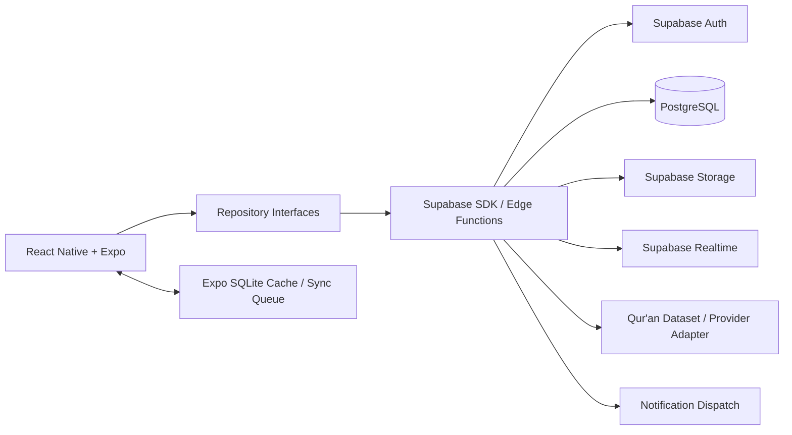
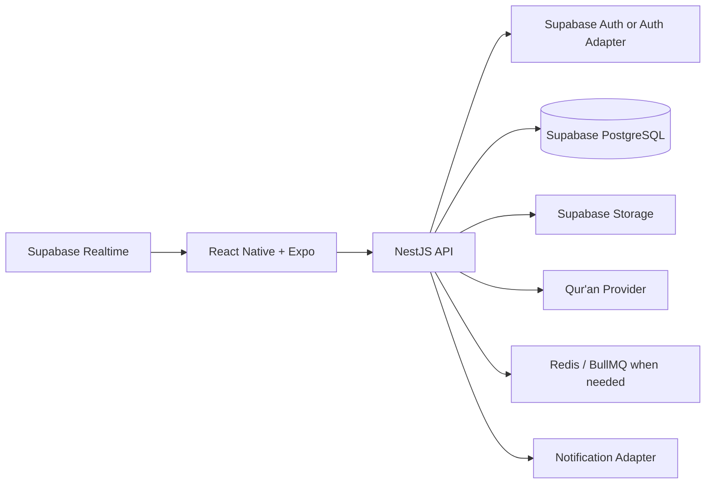
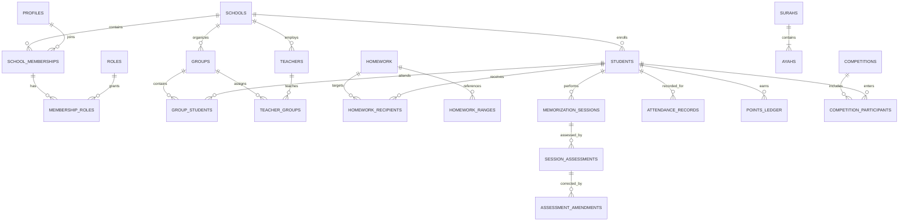

# Qur’an School Management — Project Plan

**Created:** 4 October 2026  
**Status:** Planning; application implementation has not started.  
**Primary stack for V1:** React Native + Expo + TypeScript + Supabase  
**Future backend direction:** NestJS introduced after V1 when backend complexity justifies it  
**First implementation milestone:** Version `0.1.0` — Foundation

---

## 1. How to work from this plan

This document turns the Qur’an school application brief into an ordered development backlog.

The goal is to build the first production release quickly and safely with React Native + Expo + Supabase, while deliberately avoiding tight coupling to Supabase so that NestJS can later become the main backend API without rewriting the mobile application.

- Work on one version at a time.
- Finish the pre-implementation design deliverables before writing feature code.
- Mark a task `[x]` only when its deliverable exists and its acceptance criteria have been verified.
- Keep every completed version runnable and upgradeable through migrations.
- Record architecture changes in ADRs and update this plan when scope changes.
- Use `0.x.0` milestone versions and `0.x.y` fixes.
- Keep API/versioning concerns separate from application release versions.
- Do not treat a completed checklist as proof of production readiness; release checks must also pass.
- Keep React Native features dependent on repository interfaces and domain models rather than direct Supabase queries.
- Introduce NestJS gradually only when business logic becomes complex enough to justify it.

Priority order:

1. Correct Qur’an references
2. Student privacy
3. Reliable memorization history
4. Teacher usability
5. Arabic-first experience
6. Maintainable architecture
7. Scalability
8. Gamification

---

## 2. Starting Product Requirements Document

### 2.1 Product purpose

Build an Arabic-first React Native mobile application that helps Qur’an schools manage:

- administrators
- teachers
- students
- groups
- memorization
- revision
- homework
- attendance
- scores
- healthy competitions
- notifications
- progress history

Teachers should be able to record a lesson quickly, and students should be able to see their progress, assignments, Qur’an ranges, scores, feedback, and competition status clearly.

Start with one operating school, but enforce school boundaries in the data model and authorization rules from the beginning.

Future versions should support:

- parent/guardian access
- multiple branches
- online classes
- messaging
- subscriptions/payments
- certificates
- advanced reports
- multi-school SaaS

without rebuilding the core application.

### 2.2 Users and responsibilities

| User | Primary outcome |
| --- | --- |
| Administrator | Manage school accounts, groups, terms, settings, scoring rules, reports, and competitions. |
| Teacher | Manage authorized groups, assign work, record attendance, record lesson results, score students, and identify students needing attention. |
| Student | View personal homework, Qur’an ranges, progress, history, scores, feedback, attendance, achievements, and permitted rankings. |
| Future guardian | View explicitly linked children's records and authorized teacher communication. |
| Future school/branch manager | Manage records within granted school or branch scope. |
| Future super admin | Perform separately controlled platform administration with audited access. |

### 2.3 Version 0.1 functional requirements

| ID | Requirement | Acceptance criterion |
| --- | --- | --- |
| F01 | Create a school and first administrator through a controlled bootstrap process. | Setup works without public administrator registration or manual production database edits. |
| F02 | Administrator creates teacher and student profiles. | Profiles belong to the correct school and appear only in authorized lists. |
| F03 | Support login, session restore, logout, activation, and password reset. | Valid accounts can enter the app; invalid or revoked sessions fail safely. |
| F04 | Enforce administrator, teacher, and student permissions. | Students cannot read other students; users cannot access another school. |
| F05 | Provide a minimal role-based dashboard and profile screen. | Navigation is driven by authenticated role/permissions. |
| F06 | Support Arabic and English from the first release. | Authentication, navigation, validation, and profile screens work in RTL and LTR. |
| F07 | Provide SQL migrations, typed models, repository interfaces, and automated tests. | A clean project can be initialized, migrated, seeded, and tested. |
| F08 | Record sensitive foundation actions in an audit log. | Account creation, role changes, and sensitive profile changes are traceable. |
| F09 | Keep mobile code provider-independent. | Screens/hooks do not call Supabase directly; data access goes through repositories/services. |

### 2.4 Version 0.1 boundaries

Version 0.1 includes:

- project architecture
- Supabase project setup
- school identity
- basic role permissions
- authentication
- basic teacher/student records
- profile access
- role-based navigation
- localization
- migration strategy
- repository abstraction
- CI foundation

Later versions:

- Group membership workflows begin in `0.2`
- Memorization and homework begin in `0.3`
- Qur’an reader begins in `0.4`
- Revision and attendance begin in `0.5`
- Competitions begin in `0.6`
- Realtime and notifications begin in `0.7`
- Analytics begin in `0.8`
- Complete offline write reconciliation and production hardening finish in `0.9`
- Production release is `1.0.0`

Plan the full schema early, but migrate only the tables needed by each version.

Qur’an reference metadata must be validated before memorization assignments are accepted.

### 2.5 Product quality requirements

- Keep student educational records private.
- Keep historical lessons and assessments immutable where possible.
- Correct historical records through attributed amendments rather than silent overwrite.
- Treat Arabic layout, RTL, Qur’an font rendering, accessibility, and both display directions as first-class requirements.
- Derive progress from verified lessons and unique verse coverage.
- Avoid editable aggregate totals as the source of truth.
- Keep database queries paginated and indexed.
- Use server-side validation for all sensitive state changes.
- Preserve historical meaning through schema and scoring-rule changes.
- Keep client-side code independent from the data provider where practical.
- Make migration to NestJS incremental, not a rewrite.

### 2.6 First production release success criteria

- Administrator can configure school, terms, groups, teachers, and students.
- Teacher can select Qur’an verses, assign work, record attendance, assess a lesson, and see updated progress.
- Student can open assignments in the reader and view only authorized personal educational records.
- Revision, competitions, notifications, and role dashboards work according to school settings.
- Offline lesson submissions reconcile safely without duplicated lessons, progress, or points.
- A real school completes a pilot.
- Security, migration, and backup checks pass before production.

---

## 3. Architecture recommendations

### 3.1 V1 technology stack

| Layer | Technology |
| --- | --- |
| Mobile | React Native |
| Framework | Expo |
| Language | TypeScript |
| Navigation | Expo Router |
| Server state | TanStack Query |
| Local UI state | Zustand |
| Forms | React Hook Form |
| Validation | Zod |
| Backend V1 | Supabase |
| Database | PostgreSQL on Supabase |
| Authentication | Supabase Auth |
| Authorization | PostgreSQL Row Level Security |
| Server-side logic | Supabase Edge Functions / PostgreSQL functions |
| Realtime | Supabase Realtime |
| Storage | Supabase Storage |
| Offline cache | Expo SQLite |
| Secure local values | Expo SecureStore |
| Notifications | Expo Notifications |
| Future backend | NestJS |
| Future jobs/queue | BullMQ + Redis only when needed |

### 3.2 Why Supabase first

Use Supabase for V1 because it gives:

- PostgreSQL
- authentication
- Row Level Security
- realtime subscriptions
- storage
- edge/server functions
- fast development speed
- lower infrastructure overhead

The V1 goal is not to avoid a backend forever.

The goal is to validate the product quickly while preserving a clean migration path.

### 3.3 Why NestJS later

NestJS should be introduced when the application develops substantial server-side business logic such as:

- complex multi-step transactions
- advanced competition/scoring rules
- background jobs
- certificates
- payments
- multiple third-party integrations
- advanced reports
- large-scale SaaS tenancy
- advanced auditing
- complex offline sync
- multiple mobile/web clients sharing one business API

NestJS becomes the main business API while Supabase may continue providing PostgreSQL, Auth, Storage, and Realtime.

### 3.4 V1 system shape



### 3.5 Future system shape with NestJS



### 3.6 Core migration principle

The mobile app must depend on repository contracts.

Example:

```ts
export interface StudentRepository {
  getById(id: string): Promise<Student>;
  getByGroup(groupId: string): Promise<Student[]>;
}
```

V1:

```ts
export class SupabaseStudentRepository implements StudentRepository {
  // Supabase implementation
}
```

Later:

```ts
export class NestApiStudentRepository implements StudentRepository {
  // NestJS REST implementation
}
```

React components should not care whether the data comes from Supabase or NestJS.

### 3.7 Repository interfaces to define early

- `AuthRepository`
- `SchoolRepository`
- `StudentRepository`
- `TeacherRepository`
- `GroupRepository`
- `QuranRepository`
- `HomeworkRepository`
- `MemorizationRepository`
- `AttendanceRepository`
- `CompetitionRepository`
- `AchievementRepository`
- `NotificationRepository`

---

## 4. Mobile architecture

### 4.1 Recommended application structure

```text
src/
├── app/
├── core/
│   ├── api/
│   ├── auth/
│   ├── config/
│   ├── database/
│   ├── errors/
│   ├── i18n/
│   ├── storage/
│   └── theme/
├── features/
│   ├── auth/
│   ├── dashboard/
│   ├── students/
│   ├── teachers/
│   ├── groups/
│   ├── quran/
│   ├── homework/
│   ├── memorization/
│   ├── revision/
│   ├── attendance/
│   ├── competitions/
│   ├── achievements/
│   ├── notifications/
│   └── profile/
├── repositories/
├── services/
└── shared/
    ├── components/
    ├── hooks/
    ├── types/
    └── utils/
```

### 4.2 Mobile architecture rules

- React components render state and trigger actions.
- TanStack Query handles remote/server state.
- Zustand handles small local/UI state.
- React Hook Form + Zod handle validated forms.
- Business rules should not live inside UI components.
- Supabase queries should stay inside repository implementations.
- Feature modules should own their domain-specific components, hooks, and services.
- Shared components should remain generic.
- Offline cache should not be treated as authoritative.
- Sensitive local values belong in SecureStore.
- Cached records should be partitioned by user/school.

---

## 5. Roles, permissions, and tenant isolation

Use roles plus resource scope.

Do not rely on one role string alone for long-term authorization.

### 5.1 Permission matrix

| Action | Administrator | Teacher | Student |
| --- | --- | --- | --- |
| Manage teacher/student accounts | Own school | No | No |
| Read teacher/student profiles | Own school | Own profile + students in authorized groups | Own profile only |
| Manage groups/terms/settings | Own school | Read assigned groups | Read relevant group info |
| Assign homework | With permission | Authorized groups/students | No |
| Record lessons/scores | With permission | Authorized groups/students | No |
| Record attendance | With permission | Authorized groups/students | No |
| Correct assessment | Explicit audited permission | Explicit audited permission in scope | No |
| Read scores/history | Own school | Authorized students | Own records only |
| Manage competition rules | Own school | Only if delegated | No |
| Read rankings | Policy-controlled | Policy-controlled in scope | Permitted rankings only |
| Read audit logs | Explicit permission | No by default | No |

### 5.2 Tenant isolation rules

- Every school-owned record carries `school_id`.
- Shared Qur’an reference data is global and read-only.
- Never trust a submitted `school_id` by itself.
- Validate membership and scope before access.
- RLS must protect detail queries and list queries.
- RLS must also protect realtime subscriptions.
- Teacher access must be tied to active teacher-group relationships.
- Student access must be limited to own records.
- Cross-school foreign key relationships must be prevented.
- Offline replay must re-check current authorization.
- Revoked teacher access must invalidate queued writes for that group.

---

## 6. Supabase design plan

### 6.1 Supabase features used in V1

- Auth
- PostgreSQL
- RLS
- Realtime
- Storage
- Edge Functions
- SQL migrations
- database functions/RPC where appropriate

### 6.2 Important Supabase rule

Do not let React Native perform sensitive multi-step writes directly.

For sensitive operations, use:

- PostgreSQL functions/RPC
- or Supabase Edge Functions

Examples:

- create memorization session
- complete assignment
- calculate progress
- award points
- create competition result
- create notification

### 6.3 Environment separation

Use separate Supabase projects/environments for:

- development
- staging
- production

Never reuse production service-role credentials locally.

Never place service-role keys inside the React Native application.

---

## 7. Database design plan

### 7.1 Foundation tables for 0.1

| Entity | Important fields and constraints |
| --- | --- |
| `schools` | UUID, name, default locale, timezone, status |
| `profiles` | Auth user id, school id, display name, locale, status |
| `roles` | Stable role codes |
| `permissions` | Stable permission codes |
| `role_permissions` | Role-to-permission mapping |
| `school_memberships` | School, profile/user, status |
| `membership_roles` | Membership, role |
| `teachers` | School, profile link, teacher identifier |
| `students` | School, optional account/profile link, student identifier, enrollment, level |
| `audit_logs` | School, actor, action, resource, timestamp, redacted metadata |

Student records may exist before login accounts are created.

### 7.2 Target entity catalog

| Domain | Planned entities | Design notes |
| --- | --- | --- |
| Organization | `branches`, `academic_terms`, `groups`, `group_schedules`, `teacher_groups`, `group_students` | Membership dates preserve history |
| Guardians | `guardians`, `student_guardians` | Add before parent access |
| Qur’an | `quran_datasets`, `surahs`, `ayahs`, `quran_pages`, `juz`, `hizb`, `rub_quarters` | Stable references tied to dataset/edition |
| Homework | `homework`, `homework_ranges`, `homework_recipients` | One assignment can target many students |
| Lessons | `memorization_sessions`, `session_assessments`, `assessment_amendments`, `teacher_notes` | Preserve permanent history |
| Progress | `memorization_coverage`, optional `progress_snapshots` | Derived from accepted assessments |
| Attendance | `group_meetings`, `attendance_records` | Unique per meeting/student |
| Scoring | `scoring_rule_versions`, assessment score components | Preserve applied rule version |
| Gamification | `points_ledger`, `achievements`, `student_achievements`, `competitions`, `competition_participants` | Server-generated and auditable |
| Rankings | Derived queries/views or cached snapshots | Never editable source-of-truth |
| Notifications | `notifications`, `notification_preferences`, `device_tokens` | Persistent inbox + push delivery |
| Sync | `sync_mutations` or idempotency records | Prevent duplicate replay |
| Files | `file_assets` | Private storage metadata |

### 7.3 Database invariants

- UUID primary keys.
- Use UTC `timestamptz`.
- Use school timezone for school-specific day boundaries and reporting.
- Use `created_at`, `updated_at`, and `created_by` where meaningful.
- Use immutable history for lessons and points.
- Use amendment/reversal records for corrections.
- Soft-delete mutable operational records where appropriate.
- Do not erase lesson history through ordinary profile deletion.
- Use tenant-scoped unique identifiers.
- Add indexes for school/status, group memberships, history, due dates, and sync queues.
- Validate score bounds and valid Qur’an range order.
- Prevent cross-school relationships.
- Use SQL migrations for every change.
- Test migrations on empty and upgrade databases.

### 7.4 High-level ER diagram



---

## 8. Qur’an integration and progress rules

### 8.1 Dataset selection and validation

- [ ] Select an approved Qur’an source.
- [ ] Identify riwayah, orthography, mushaf edition, and page layout.
- [ ] Confirm licensing for text, offline storage, fonts, search, and future audio.
- [ ] Store source provenance and dataset version.
- [ ] Validate Surah count, Ayah counts, sequence, and text integrity.
- [ ] Validate page/Juz/Hizb/quarter mappings.
- [ ] Define Basmala handling.
- [ ] Obtain knowledgeable human review before production usage.
- [ ] Keep provider IDs out of domain contracts where possible.
- [ ] Preserve dataset version on historical assignments.

### 8.2 Qur’an reference model

Use:

```ts
export type QuranReference = {
  surahId: number;
  ayahNumber: number;
};

export type QuranRange = {
  start: QuranReference;
  end: QuranReference;
};
```

Do not use strings like:

```text
"Al-Baqarah 10-20"
```

as the authoritative representation.

### 8.3 Assignment types

Support:

- new memorization
- recent revision
- old revision
- full Surah review
- Juz review
- reading
- Tajweed exercise
- custom homework

### 8.4 Assignment semantics

- Custom tasks may omit Qur’an ranges.
- Qur’an-based tasks require validated ranges.
- One assignment may target one student, many students, or an entire group.
- Each recipient has independent state.
- Suggested recipient states:
  - assigned
  - in_progress
  - awaiting_review
  - completed
  - needs_revision
  - cancelled
- Overdue should be derived from due date + effective status.
- Student self-completion and teacher verification must remain separate.
- Actual assessed range may differ from assigned range.
- Save score components, mistakes, prompts, notes, and pass/revision decision.
- Snapshot scoring policy/version for historical explainability.

### 8.5 Correct progress calculation

- Teacher-accepted memorization assessments determine verified coverage.
- Count the union of verified ranges.
- Do not sum overlapping lesson lengths.
- Revision does not increase new memorized totals.
- A Surah/Juz is complete when required verses are fully covered.
- Current position and total coverage are separate concepts.
- Students may memorize non-linearly.
- Baseline imported memorization must preserve provenance.
- Corrections should affect projections through amendment records.
- Original assessments remain available.
- Progress updates should happen transactionally.

Example:

```text
Lesson 1: Al-Baqarah 1–20
Lesson 2: Al-Baqarah 15–30
```

Incorrect total:

```text
36 verses
```

Correct unique coverage:

```text
30 verses
```

---

## 9. Authentication strategy

### 9.1 Initial login model

Recommended baseline:

```text
Administrator → email/password
Teacher       → email/password
Student       → optional account, provisioned only when the student has a verified private email or phone for account recovery
```

Student records are independent of authentication accounts, so a school can enroll a student without collecting personal contact details. In V1, an administrator provisions an optional student account only when the student can privately access a verified recovery contact. Do not use shared student accounts, fabricated email addresses, or a custom username-to-Supabase login bridge. Students who do not meet this condition can still have profiles and be managed through authorized school workflows; defer their direct app login until a secure recovery method is designed.

### 9.2 Authentication flow

```text
Login
  ↓
Supabase Auth
  ↓
Load profile + membership
  ↓
Determine role/permissions
  ↓
Role-based navigation
```

### 9.3 Security rules

- Never store service-role credentials in the app.
- Store mobile auth state securely.
- Use Supabase session refresh.
- Support logout/revocation.
- Use Supabase password recovery only for verified account contacts, with generic responses that do not reveal whether an account exists.
- Do not let staff view existing passwords; account recovery must use the provider's secure recovery flow.
- Disable inactive accounts.
- Keep authorization in the database/backend, not just navigation.
- Audit role and profile changes.

---

## 10. RLS security model

### 10.1 Student rules

Student can:

- read own profile
- read own homework
- read own progress
- read own scores
- read own attendance
- read permitted competition data

Student cannot:

- read another student
- modify scores
- modify verified progress
- modify competition points
- access another school

### 10.2 Teacher rules

Teacher can:

- read assigned groups
- read students in assigned groups
- create homework for authorized students
- record attendance for authorized groups
- record lesson results for authorized students
- read authorized progress/history

Teacher cannot:

- access unrelated groups
- access another school
- award arbitrary client-side points
- modify protected historical records without amendment permission

### 10.3 Administrator rules

Administrator can:

- manage school-owned users
- manage groups
- manage terms
- manage school settings
- manage competitions
- view school-level reports

Administrator cannot:

- access another school
- bypass platform-wide isolation

### 10.4 Required RLS tests

- unauthenticated access denied
- student-to-student data access denied
- teacher wrong-group access denied
- cross-school access denied
- unauthorized update denied
- realtime subscription leakage denied

---

## 11. API and backend planning for V1

V1 does not require a full custom REST API.

Use:

- repository methods calling Supabase directly for safe/simple CRUD
- PostgreSQL RPC/functions for transactional database operations
- Supabase Edge Functions for server-only workflows and external integrations

### 11.1 Operations suitable for direct repository queries

Examples:

- read own profile
- list authorized groups
- read student list permitted by RLS
- read assignments
- read progress
- read notifications

### 11.2 Operations that should be server-controlled

Examples:

- submit memorization session
- update assignment completion
- calculate progress
- award points
- apply competition rules
- create sensitive notifications
- amend historical assessment
- bulk assign homework

### 11.3 Example V1 command

```text
submitMemorizationSession()
        ↓
validate current user
        ↓
validate teacher/group/student relationship
        ↓
validate Qur'an range
        ↓
insert session
        ↓
insert assessment
        ↓
update assignment state
        ↓
update/rebuild progress projection
        ↓
award points if rules apply
        ↓
create audit record
        ↓
create notification
```

---

## 12. Future NestJS migration strategy

### 12.1 Stage 1 — Supabase only

```text
React Native
    ↓
Repositories
    ↓
Supabase
```

This is V1.

### 12.2 Stage 2 — Hybrid

Move complex commands to NestJS first.

```text
React Native
    │
    ├── Simple reads → Supabase
    │
    └── Complex writes → NestJS
```

Examples:

```text
POST /memorization/sessions
POST /homework/group
POST /attendance
POST /competitions
```

### 12.3 Stage 3 — NestJS main API

```text
React Native
      ↓
    NestJS
      ↓
PostgreSQL
```

Supabase may continue to provide:

- Auth
- PostgreSQL hosting
- Storage
- Realtime

### 12.4 Stage 4 — Optional full independence

Only if required:

```text
React Native
      ↓
NestJS
      ↓
PostgreSQL
Redis
Workers
Object Storage
Push Provider
```

Do not do this unless there is a real operational or business reason.

### 12.5 Future NestJS module structure

```text
apps/
├── mobile/
└── api/
    └── src/
        ├── auth/
        ├── schools/
        ├── users/
        ├── teachers/
        ├── students/
        ├── groups/
        ├── quran/
        ├── homework/
        ├── memorization/
        ├── revision/
        ├── attendance/
        ├── competitions/
        ├── achievements/
        ├── notifications/
        └── analytics/
```

### 12.6 Future NestJS flow

```text
Controller
    ↓
Use Case
    ↓
Domain Logic
    ↓
Repository
    ↓
PostgreSQL
```

Example:

```text
POST /memorization/sessions
        ↓
CreateMemorizationSession
        ↓
CheckTeacherAccess
        ↓
ValidateQuranRange
        ↓
CreateSession
        ↓
UpdateProgress
        ↓
AwardPoints
        ↓
CreateNotification
```

---

## 13. Mobile navigation and screens

### 13.1 Navigation by role

| Role | Primary destinations |
| --- | --- |
| Administrator | Dashboard, People, Groups, Reports, More/Settings |
| Teacher | Dashboard, Groups, Homework, Qur’an, More/Profile |
| Student | Dashboard, Homework, Qur’an, Progress, More/Profile |

### 13.2 Screen inventory

| Version | Screens |
| --- | --- |
| 0.1 | App launch/session restore, login, forgot/reset password, role home, profile, admin people list/editor, language/theme settings |
| 0.2 | Group list/details/editor, teacher assignment, student enrollment/transfer, term management, schedule |
| 0.3 | Homework list/create/details, recipient selection, lesson recording, assessment details, history, progress summary |
| 0.4 | Qur’an reader, Surah/Juz/page navigation, search, bookmarks, Ayah selection, highlighted homework ranges |
| 0.5 | Revision list/history, attendance entry/history, revision summary |
| 0.6 | Competition list/details, leaderboard, achievements, points explanation |
| 0.7 | Notification inbox, preferences, deep links |
| 0.8 | Complete teacher/student/admin dashboards and reports |
| 0.9 | Sync status, pending queue, conflict review, recovery states |

### 13.3 Core flows

1. Administrator creates school users → creates groups → assigns teachers/students.
2. Teacher opens group → student → assignment → records lesson → sees updated progress → assigns next work.
3. Teacher opens Qur’an → selects first/last Ayah → validates → chooses students → publishes homework.
4. Student opens homework → opens highlighted Qur’an range → sees teacher result after assessment.
5. Teacher records offline result → app shows pending → server revalidates access → sync succeeds once or produces explicit conflict.
6. Administrator configures competitions → server awards points → rankings respect visibility policy.

---

## 14. Homework design

### 14.1 Tables

```text
homework
homework_ranges
homework_recipients
```

### 14.2 Why recipient records matter

One assignment definition may target many students.

```text
Homework
   │
   ├── Qur'an Range
   ├── Student A
   ├── Student B
   ├── Student C
   └── Student D
```

Each recipient can have independent:

- status
- completion date
- score
- notes
- override due date if needed

### 14.3 Teacher flow

```text
Choose Qur'an range
        ↓
Select assignment type
        ↓
Select student(s)/group
        ↓
Choose deadline
        ↓
Add instructions
        ↓
Publish
```

---

## 15. Memorization session design

### 15.1 Suggested fields

```text
student_id
teacher_id
group_id
assignment_recipient_id
session_date

start_surah_id
start_ayah_number
end_surah_id
end_ayah_number

accuracy_score
tajweed_score
fluency_score
overall_score

mistakes_count
prompts_count

result
teacher_notes
created_at
```

### 15.2 Example teacher form

```text
Ahmed Mohamed

Al-Baqarah 50–60

Accuracy       9/10
Tajweed        8/10
Fluency        9/10

Mistakes       2
Prompts        1

Result
PASSED

Teacher Notes
[........................]

[Save Session]
```

### 15.3 Rule

React Native must not independently perform:

```text
create session
update progress
complete homework
award points
create notification
```

Those operations belong in one controlled server transaction/workflow.

---

## 16. Revision design

Revision must be distinct from new memorization.

Example:

```text
NEW
Al-Baqarah 100–110
```

```text
REVISION
Al-Baqarah 1–50
```

Revision affects:

- revision completion
- revision frequency
- retention indicators
- recent revision
- old revision

Revision must not increase total new memorized verse coverage.

---

## 17. Attendance design

Tables:

```text
group_meetings
attendance_records
```

Statuses:

```text
present
absent
late
excused
```

Example:

```text
Saturday Class

Ahmed       Present
Mohamed     Present
Omar        Absent
Youssef     Late
```

Attendance corrections must be auditable.

---

## 18. Gamification and competitions

### 18.1 Points must use a ledger

Do not store only:

```text
student.points = 760
```

Use:

```text
points_ledger
```

Example:

```text
Ahmed

+10 Homework completed
+20 Perfect lesson
+50 Surah completed
+10 Revision
-10 Correction
```

Total is derived:

```text
SUM(points_ledger.points)
```

### 18.2 Tables

```text
competitions
competition_participants
points_ledger
achievements
student_achievements
```

### 18.3 Competition categories

Do not only reward memorization volume.

Support:

- Highest Score
- Best Improvement
- Best Attendance
- Best Revision
- Best Consistency
- Homework Champion

### 18.4 Ranking privacy

- Public rankings must be configurable.
- School may disable rankings.
- Child privacy must override gamification.
- Clients must never award their own points.

---

## 19. Realtime and notifications

Use Supabase Realtime selectively.

Good use cases:

- new homework
- new score
- teacher feedback
- competition update
- important notification

Do not subscribe every screen to every table.

Use a persistent:

```text
notifications
```

table as the source of truth.

Flow:

```text
Database notification
        ↓
Push delivery
        ↓
Expo notification
        ↓
Student device
```

Push notification delivery is not the source of notification history.

---

## 20. Offline synchronization strategy

Design offline from the beginning even if full offline writes arrive later.

### 20.1 Cache offline

Allow offline access to:

- Qur’an content
- recent assignments
- recent student profiles
- recent progress
- recent group lists

### 20.2 Local queue

Use Expo SQLite.

Suggested table:

```text
pending_mutations

id
user_id
school_id
type
payload
schema_version
created_at
status
attempt_count
```

### 20.3 Offline write flow

```text
Teacher records lesson
       ↓
Save local pending mutation
       ↓
Display PENDING
       ↓
Internet returns
       ↓
Re-check user and teacher authorization
       ↓
Validate current assignment/resource state
       ↓
Commit once
       ↓
Mark SYNCED
```

### 20.4 Idempotency requirements

Every replayable mutation requires a stable mutation/idempotency key.

Retries with the same key and payload return the same result.

Same key with different payload must be rejected.

### 20.5 Conflict examples

- teacher removed from group while offline
- assignment cancelled
- same student assessed on another device
- stale record version
- student moved to another group

Do not silently use last-write-wins for educational assessment data.

---

## 21. Security and privacy plan

- [ ] Threat-model cross-school access, IDOR, unauthorized grading, token theft, upload abuse, and offline replay.
- [ ] Use Supabase Auth securely.
- [ ] Use RLS for all exposed school-owned tables.
- [ ] Keep service-role keys server-side only.
- [ ] Validate every mutation.
- [ ] Keep scores, points, verified progress, and competition eligibility server-controlled.
- [ ] Use HTTPS/TLS only.
- [ ] Use SecureStore for sensitive mobile values.
- [ ] Keep private uploads in private storage buckets.
- [ ] Use signed URLs or authorized access patterns.
- [ ] Redact tokens and child-sensitive fields from logs.
- [ ] Audit sensitive updates and corrections.
- [ ] Define retention and deletion/anonymization rules before real student data is used.
- [ ] Revalidate authorization on offline replay.
- [ ] Test RLS for direct reads, updates, realtime, and storage.

---

## 22. Testing strategy

| Layer | Required coverage |
| --- | --- |
| Unit | Qur’an ranges, coverage union, scoring, state transitions, repository/use-case behavior |
| PostgreSQL / Supabase integration | Constraints, RLS, transactions, idempotency, migrations |
| Repository | Supabase repository behavior and error mapping |
| React Native component | Navigation, loading/error/empty states, Arabic RTL, English LTR |
| Mobile end-to-end | Login, group setup, homework, lesson evaluation, privacy, notification, offline replay |
| Dataset validation | Qur’an counts, order, boundaries, checksums, page/Juz mappings |
| Security | Cross-school access, unauthorized score updates, direct client manipulation |
| Operations | Backup restoration, migration rehearsal, release candidate smoke tests |

Critical scenarios:

- teacher cannot access unauthorized groups
- student cannot access another student
- cross-school IDs fail
- client cannot change points
- client cannot modify verified scores
- overlapping ranges do not double count
- revision does not inflate memorized totals
- corrections preserve original history
- retried writes commit once

---

## 23. Deployment and operations strategy

- Separate development, staging, and production Supabase projects.
- Keep separate app environment files/configuration.
- Never commit secrets.
- Use EAS Build/Submit for React Native/Expo distribution where appropriate.
- Run linting, type checks, tests, and build checks in CI.
- Apply SQL migrations through controlled deployment flow.
- Deploy to staging first.
- Run smoke tests before production promotion.
- Configure crash reporting.
- Monitor app errors, database saturation, slow queries, realtime failures, and sync conflict rates.
- Configure backups and point-in-time recovery where available.
- Test restoration.
- Introduce Redis/workers only when workloads justify them.
- Document rollback procedures.

---

## 24. Pre-implementation documentation milestone

Complete these deliverables before feature development.

| Done | Deliverable | Planned file | Completion criterion |
| --- | --- | --- | --- |
| [x] | Product Requirements Document | `docs/product/PRD.md` | Users, V1 requirements, priorities, boundaries, acceptance criteria |
| [x] | System architecture | `docs/architecture/SYSTEM_ARCHITECTURE.md` | V1 Supabase architecture + future NestJS migration |
| [x] | Role/permission matrix | `docs/architecture/PERMISSIONS.md` | Role/resource scope and denial cases |
| [x] | Database ER diagram | `docs/architecture/ERD.md` | Full relationships and tenancy |
| [x] | Complete database schema | `docs/architecture/DATABASE_SCHEMA.md` | Fields, types, keys, indexes, checks, migrations |
| [x] | Data access strategy | `docs/architecture/DATA_ACCESS.md` | Repository interfaces and Supabase implementations |
| [x] | Mobile navigation | `docs/product/NAVIGATION.md` | Role routes, protected routes, deep links, RTL/LTR |
| [x] | Screen list | `docs/product/SCREENS.md` | Purpose, version, permissions, states |
| [x] | User flows | `docs/product/USER_FLOWS.md` | Main journeys and failure paths |
| [x] | Folder structure | `docs/architecture/FOLDER_STRUCTURE.md` | Feature ownership and dependency direction |
| [x] | State strategy | `docs/architecture/STATE_MANAGEMENT.md` | TanStack Query + Zustand responsibilities |
| [x] | Supabase architecture | `docs/architecture/SUPABASE.md` | RLS, Edge Functions, RPC, Realtime, Storage |
| [x] | NestJS migration plan | `docs/architecture/NESTJS_MIGRATION.md` | Hybrid and main-API stages |
| [x] | Qur’an integration | `docs/quran/INTEGRATION.md` | Candidate, licensing status/questions, validation gates, and reference model; final source approval required before 0.3 |
| [x] | Security plan | `docs/security/SECURITY_PLAN.md` | Threat model, auth, RLS, privacy, audit |
| [x] | Offline sync | `docs/offline/SYNC_STRATEGY.md` | Queue, idempotency, conflict handling |
| [x] | Testing strategy | `docs/testing/TEST_STRATEGY.md` | Required scenarios and release evidence |
| [x] | Deployment strategy | `docs/deployment/DEPLOYMENT.md` | Environments, migrations, backups, release |
| [x] | Version roadmap | `docs/product/ROADMAP.md` | Milestones, dependencies, gates |

Also create ADRs for:

- Supabase-first backend choice
- React Native + Expo choice
- TanStack Query + Zustand
- tenant isolation
- Qur’an reference model
- immutable history
- progress calculation
- offline replay
- NestJS migration strategy

---

## 25. Planned repository structure

```text
quran-school-management/
├── PROJECT_PLAN.md
├── README.md
├── CHANGELOG.md
├── docs/
│   ├── product/
│   ├── architecture/
│   ├── quran/
│   ├── security/
│   ├── offline/
│   ├── testing/
│   └── deployment/
├── apps/
│   └── mobile/
│       ├── app/
│       ├── src/
│       │   ├── core/
│       │   ├── features/
│       │   ├── repositories/
│       │   ├── services/
│       │   └── shared/
│       ├── assets/
│       └── tests/
├── supabase/
│   ├── migrations/
│   ├── functions/
│   ├── seed.sql
│   └── config/
├── packages/
│   ├── domain/
│   ├── validation/
│   └── shared-types/
├── scripts/
└── .github/
    └── workflows/
```

Future:

```text
apps/
├── mobile/
└── api/        # NestJS added later
```

Avoid empty placeholder modules.

---

## 26. Version implementation roadmap

### 0.1.0 — Foundation

Dependencies: documentation gate.

- [ ] Create Git repository structure.
- [ ] Create Expo + TypeScript application.
- [ ] Add Expo Router.
- [ ] Add TanStack Query.
- [ ] Add Zustand.
- [ ] Add React Hook Form + Zod.
- [ ] Create Supabase development project.
- [ ] Create first SQL migrations.
- [ ] Create schools, profiles, roles, memberships, teachers, students, audit tables.
- [ ] Create controlled first-admin bootstrap.
- [ ] Implement Supabase Auth.
- [ ] Implement repository interfaces.
- [ ] Implement Supabase repository adapters.
- [ ] Add role-based navigation.
- [ ] Add Arabic/English localization.
- [ ] Add RTL/LTR support.
- [ ] Add base theme and accessible components.
- [ ] Add RLS foundation.
- [ ] Add unit/component/integration tests.
- [ ] Add CI.
- [ ] Update README and CHANGELOG.
- [ ] Prepare tag `v0.1.0`.

**Acceptance:**  
Admin, teacher, and student accounts can authenticate and see correct foundation screens. Cross-school reads fail. Mobile screens do not contain direct Supabase data-access logic. Arabic and English both work.

---

### 0.2.0 — Group management

- [ ] Add academic terms.
- [ ] Add groups.
- [ ] Add schedules.
- [ ] Add teacher-group memberships.
- [ ] Add dated student-group memberships.
- [ ] Implement group administration.
- [ ] Implement teacher assignment.
- [ ] Implement student assignment/transfer.
- [ ] Enforce group-level RLS.
- [ ] Expand student profile with current group/teacher/level.
- [ ] Test transfer history and inactive memberships.
- [ ] Prepare tag `v0.2.0`.

**Acceptance:**  
Administrators manage groups. Teachers see only assigned groups and students. Transfers preserve history.

---

### 0.3.0 — Memorization and homework

- [ ] Import validated Qur’an reference metadata.
- [ ] Implement `QuranReference` and `QuranRange`.
- [ ] Add homework.
- [ ] Add homework ranges.
- [ ] Add homework recipients.
- [ ] Support single/multiple/group assignments.
- [ ] Add memorization sessions.
- [ ] Add assessment fields.
- [ ] Add historical amendments.
- [ ] Add progress coverage logic.
- [ ] Add idempotency keys.
- [ ] Add server-side transaction/RPC or Edge Function for lesson submission.
- [ ] Test overlapping verse ranges.
- [ ] Test unauthorized score edits.
- [ ] Prepare tag `v0.3.0`.

**Acceptance:**  
Teacher can assign and assess valid Qur’an ranges. Student history updates. Overlapping ranges do not inflate progress.

---

### 0.4.0 — Qur’an reader

- [ ] Integrate approved Qur’an text source.
- [ ] Add Surah navigation.
- [ ] Add Ayah navigation.
- [ ] Add page navigation.
- [ ] Add Juz navigation.
- [ ] Add bookmarks.
- [ ] Add permitted search.
- [ ] Add Ayah selection.
- [ ] Add range highlighting.
- [ ] Create homework from selected verses.
- [ ] Open student homework directly to highlighted range.
- [ ] Cache approved Qur’an content offline.
- [ ] Test Arabic rendering on real devices.
- [ ] Prepare tag `v0.4.0`.

**Acceptance:**  
Selecting Al-Baqarah 10–20 creates a valid assignment and opens exactly that range in the student reader.

---

### 0.5.0 — Revision and attendance

- [ ] Add recent revision.
- [ ] Add old revision.
- [ ] Add full-Surah review.
- [ ] Add Juz review.
- [ ] Keep revision separate from memorized coverage.
- [ ] Add group meetings.
- [ ] Add attendance records.
- [ ] Add attendance history.
- [ ] Add authorized corrections.
- [ ] Define attendance rate policy.
- [ ] Test duplicate attendance prevention.
- [ ] Prepare tag `v0.5.0`.

**Acceptance:**  
Teachers record attendance and revision. Revision does not increase memorized totals.

---

### 0.6.0 — Gamification and competitions

- [ ] Add points ledger.
- [ ] Add points rule versions.
- [ ] Add achievements.
- [ ] Add student achievements.
- [ ] Add competitions.
- [ ] Add participants.
- [ ] Add weekly/monthly rankings.
- [ ] Add category-based awards.
- [ ] Add ranking privacy settings.
- [ ] Keep awards server-generated.
- [ ] Test duplicate award prevention.
- [ ] Test correction/reversal events.
- [ ] Prepare tag `v0.6.0`.

**Acceptance:**  
Points are awarded once, are auditable, and cannot be manipulated by the client.

---

### 0.7.0 — Realtime and notifications

- [ ] Add notification table.
- [ ] Add notification preferences.
- [ ] Add Expo push tokens.
- [ ] Add Supabase Realtime subscriptions.
- [ ] Add homework notifications.
- [ ] Add score notifications.
- [ ] Add teacher feedback notifications.
- [ ] Add competition notifications.
- [ ] Add deep links.
- [ ] Test reconnect behavior.
- [ ] Test authorization changes during subscriptions.
- [ ] Prepare tag `v0.7.0`.

**Acceptance:**  
Authorized users receive relevant updates without data leakage.

---

### 0.8.0 — Analytics and dashboards

- [ ] Add daily/weekly/monthly progress.
- [ ] Add memorization speed.
- [ ] Add revision consistency.
- [ ] Add score trends.
- [ ] Add attendance metrics.
- [ ] Add homework completion metrics.
- [ ] Complete teacher dashboard.
- [ ] Complete student dashboard.
- [ ] Complete admin dashboard.
- [ ] Add explainable attention flags.
- [ ] Add charts.
- [ ] Add required indexes.
- [ ] Test reporting windows and timezone rules.
- [ ] Prepare tag `v0.8.0`.

**Acceptance:**  
Dashboard metrics reconcile with history and remain correctly scoped.

---

### 0.9.0 — Offline, security, and production hardening

- [ ] Add Expo SQLite cache.
- [ ] Cache Qur’an content.
- [ ] Cache recent groups/students/assignments/progress.
- [ ] Add pending mutation queue.
- [ ] Add offline lesson capture.
- [ ] Add idempotent replay.
- [ ] Add explicit conflict handling.
- [ ] Test app restart during pending sync.
- [ ] Test multiple devices.
- [ ] Test revoked access during replay.
- [ ] Perform RLS review.
- [ ] Perform security testing.
- [ ] Add crash reporting.
- [ ] Add monitoring.
- [ ] Test backups and restoration.
- [ ] Test staging-to-production release.
- [ ] Prepare tag `v0.9.0`.

**Acceptance:**  
Offline lesson results synchronize once. Conflicts are explicit. No unresolved critical privacy/history issue remains.

---

### 1.0.0 — First production release

- [ ] Run pilot with real school users.
- [ ] Resolve release blockers.
- [ ] Verify end-to-end teacher workflow.
- [ ] Verify end-to-end student workflow.
- [ ] Verify admin workflow.
- [ ] Verify privacy/consent decisions.
- [ ] Verify backups and recovery ownership.
- [ ] Finish onboarding/help.
- [ ] Complete release notes.
- [ ] Prepare tag `v1.0.0`.
- [ ] Promote validated release candidate.

**Acceptance:**  
The school can run its normal teaching workflow reliably.

---

## 27. Future versions and extension points

| Version | Planned scope | Prepare now |
| --- | --- | --- |
| 1.1 | Parent/guardian access | Guardian links and child-scoped permissions |
| 1.2 | Multiple branches | Optional branch scope |
| 1.3 | Online classes | Provider adapters and schedule identities |
| 1.4 | Messaging | Consent, moderation, retention |
| 1.5 | Subscriptions/payments | Entitlements and billing adapters |
| 1.6 | Advanced competitions | Versioned rule engine |
| 1.7 | Certificates | Achievement evidence and templates |
| 1.8 | Advanced reports | Exportable longitudinal reports |
| 2.0 | Multi-school SaaS | Onboarding, branding, billing, platform admin |

Potential AI later:

- revision recommendations
- forgetting-risk indicators
- teacher progress summaries
- homework recommendations
- school reports

AI must not silently modify verified Qur’an history.

Automatic recitation grading should not be added until a suitable Qur’an-aware speech-recognition system has been carefully evaluated.

---

## 28. When to introduce NestJS

Do not add NestJS because a version number says so.

Introduce it when there is clear pressure from complexity.

Good signals:

- many Edge Functions
- complex transactions
- many business rules
- complex competition engine
- background jobs
- scheduled reports
- certificates
- payments
- many integrations
- complex audit requirements
- SaaS tenant management
- multiple web/mobile clients
- large-scale offline synchronization

A likely transition point could be around `1.5` to `2.0`, but the actual decision should be evidence-driven.

---

## 29. Shared definition of done

Apply after every version:

- [ ] Acceptance criteria implemented and reviewed.
- [ ] Unit tests pass.
- [ ] Integration tests pass.
- [ ] RLS/authorization tests pass.
- [ ] Relevant mobile tests pass.
- [ ] SQL migrations are committed and tested.
- [ ] Arabic and English are reviewed.
- [ ] RTL/LTR layouts are reviewed.
- [ ] README updated.
- [ ] CHANGELOG updated.
- [ ] Architecture docs updated if needed.
- [ ] Staging smoke tests pass.
- [ ] Release notes explain changes and known limitations.
- [ ] Tag `vX.Y.Z` created after release checks pass.

Recommended branches:

```text
main
develop
feature/*
fix/*
release/*
```

Keep `main` releasable.

---

## 30. Decisions and risks to resolve

Hamdy Abd Elmohsen is provisionally assigned as Product Owner, Technical Lead, and School Representative. A qualified Qur’an Reviewer and privacy/legal reviewer are still TBD and must be named before their respective approvals. The School Representative confirms school policy; the Qur’an Reviewer validates religious content and edition-specific decisions. The school jurisdiction is Egypt.

| Decision/risk | Proposed working assumption or mitigation | Needed by | Owner |
| --- | --- | --- | --- |
| Target platforms | Android + iOS | 0.1 | Hamdy Abd Elmohsen (provisional Product Owner) |
| Student login model | Student profiles do not require accounts; optional accounts require a verified private recovery contact. Use Supabase recovery; no shared accounts or custom username bridge in V1. | Documentation gate | Hamdy Abd Elmohsen; School Representative TBD |
| Qur’an source | Approved source with verified metadata | Before 0.3 | Qur’an Reviewer TBD |
| Qur’an licensing | Verify offline/text/font rights | Before 0.3 | Hamdy Abd Elmohsen; Qur’an Reviewer TBD |
| School timezone | Stored per school; exact value to be supplied by the school | 0.1 | Hamdy Abd Elmohsen (provisional School Representative) |
| Privacy/retention | Apply qualified review for Egypt before real student data | Before pilot | Hamdy Abd Elmohsen; qualified privacy/legal reviewer TBD |
| Scoring model | Versioned server-side policy | 0.3 | Hamdy Abd Elmohsen |
| Group membership | One active initially, historical memberships retained | 0.2 | Hamdy Abd Elmohsen |
| Page completion | Edition-specific calculation | 0.3 | Qur’an Reviewer TBD; Hamdy Abd Elmohsen |
| Teacher note visibility | Private by default unless explicitly shared | 0.3 | Hamdy Abd Elmohsen |
| Child rankings | School-configurable and privacy-limited | 0.6 | Hamdy Abd Elmohsen |
| Offline conflicts | Explicit reconciliation, no silent overwrite | 0.9 | Hamdy Abd Elmohsen |
| NestJS timing | Introduce only when complexity justifies it | Post-V1 | Hamdy Abd Elmohsen |
| Supabase dependency | Isolate behind repositories | 0.1 | Hamdy Abd Elmohsen |

---

## 31. Immediate next work

1. Write `docs/product/PRD.md`.
2. Write `docs/architecture/SYSTEM_ARCHITECTURE.md`.
3. Write `docs/architecture/PERMISSIONS.md`.
4. Write `docs/architecture/ERD.md`.
5. Write `docs/architecture/DATABASE_SCHEMA.md`.
6. Write `docs/architecture/DATA_ACCESS.md`.
7. Write `docs/architecture/SUPABASE.md`.
8. Write `docs/architecture/NESTJS_MIGRATION.md`.
9. Write `docs/quran/INTEGRATION.md`.
10. Write `docs/security/SECURITY_PLAN.md`.
11. Write `docs/offline/SYNC_STRATEGY.md`.
12. Write `docs/testing/TEST_STRATEGY.md`.
13. Write `docs/deployment/DEPLOYMENT.md`.
14. Validate all architecture decisions.
15. Implement only version `0.1.0`.
16. Complete release checks before starting `0.2.0`.

---

## 32. Final architecture principle

> Build Version 1 on Supabase, but design the application around your own domain models, repository interfaces, validation rules, and feature modules — not around Supabase itself.

This gives the project:

- fast V1 development
- strong PostgreSQL foundation
- secure RLS-based access
- clean React Native code
- easier testing
- easier future NestJS migration
- less rewrite risk
- a clear path toward a scalable Qur’an school platform

**Current completion:** The master plan exists. All implementation and design checkboxes remain open.
